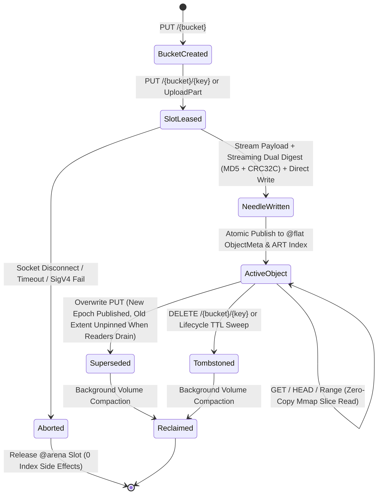

# Awan Storage Architecture Specification

> **Engine Internals: Columnar Memory Model, Sparse Virtual Volumes, Staged Multipart Extents, MVCC Lifecycle, and Kernel I/O**

---

## 0. Decisions (2026-11-12)

Owner decisions after the 2026-11-12 audit. The milestones Phase 1-4 on GitHub carry the issues; [`ROADMAP_AND_DEPENDENCIES.md`](ROADMAP_AND_DEPENDENCIES.md) shows the order.

| # | Decision | Issues |
|---|---|---|
| 1 | **Durability:** group commit is the default (a 200 means the bytes are on stable storage). `--durability=fast` (background flush at least once a second; a power cut loses at most about the last second) and `--durability=strict` (sync each write) are opt-in. Reason: AwanFS is single-node; servers that skip fsync by default (Garage, SeaweedFS) keep copies on other nodes. Recovery must not stop at a gap first. | #29, #38 |
| 2 | **Authentication:** bind 127.0.0.1 by default; verify SigV4 against keys from the environment; anonymous access only behind an explicit flag. IAM policies and TLS follow as separate issues. | #35, #53, #30 |
| 3 | **Performance gates:** no absolute MiB/s targets. Layer 1: exact work counts per request type in `server/tests/work_count_test.rs` (every PR, both platforms). Layer 2: nightly AwanFS/MinIO throughput ratio on the same runner (`benchmarks/ratio_check.py`, baseline `benchmarks/ratio_baseline.json`). | #33, #34 |
| 4 | **Order:** correctness and security first (Phase 1), then production operations (Phase 2), then scale and efficiency (Phase 3), multi-node last (Phase 4). | milestones |
| 5 | **Topology:** single node; operators use RAID or ZFS for disk failure. Multi-node clustering is a design issue for when a production deployment needs high availability; `libs/awan-cluster` from awan-lang is an input to the design, not code to port. | #52, #27, #15 |
| 6 | **Metadata:** keep the redb spill index; review it with the tiered metadata and Bloom filter work after Phase 1. | #13, #26 |
| 7 | **Compression:** opt-in per bucket, in independent 64 KiB blocks so range GETs stay cheap; off by default. | #51 |
| 8 | **Observability:** structured logs with request IDs, Prometheus `/metrics`, OpenTelemetry traces, health endpoints, a Grafana dashboard and alert rules, and an S3 access log. | #41-#46 |

### Decisions (2026-11-13)

Owner decisions after the 2026-11-12 unattended run (#64-#83), each the recommended option.

| # | Decision | Issues |
|---|---|---|
| 9 | **Admin endpoints** live under `/_awanfs/` (`health/live`, `health/ready`, `metrics`), unauthenticated. `_` is not allowed in bucket names, so they never shadow a bucket. A separate admin port may follow if metrics must stay off the public port. | #44, #42 |
| 10 | **Ratio baseline:** the PUT rows are re-recorded from the lowest ratio of about five nightly runs with group durability, not from one run. | #34, #29 |
| 11 | **Logging:** the hand-written JSON request line stays until #43; tracing and tracing-subscriber come with OpenTelemetry, with the same field names. | #41, #43 |
| 12 | **Configuration:** flags and `AWANFS_*` variables for now; a TOML file comes with IAM. | #49, #53 |
| 13 | **Disk-space alerting:** no "volume above 85 %" alert, because a full volume rolls over (#37); free space comes from node_exporter. | #45 |
| 14 | **aws-chunked bodies:** every chunk's signature is verified (next Phase 1 item), not left to TLS. | #35, #30 |
| 15 | **Compaction:** automatic when the oldest volume is at least 20 % dead space, with a switch to turn it off; manual compaction stays available. | #14 |
| 16 | **Kept as built:** the journal is synced with the volume (2 syncs per lone write); group commit has no fixed batch window; the library default accepts unsigned requests while the binary needs keys or `--allow-anonymous`; bodies above 4 MiB stream to disk; new volumes are not sparse; ready is 503 only when no write can succeed. | #29, #35, #36, #37, #44 |

### Decisions (2026-11-13, second set)

| # | Decision | Issues |
|---|---|---|
| 17 | **New crates** reach Cargo.lock through a manual CI workflow that runs `cargo update` and opens a PR; CI keeps `--locked`. | all |
| 18 | **TLS:** `--cert`/`--key` with rustls; files reloaded when they change (checked every 60 s) and on SIGHUP; plain HTTP off when a certificate is set unless `--http-port`. No ACME. | #30 |
| 19 | **IAM:** a subset of AWS policy JSON (Effect, Action `s3:*`, Resource `arn:aws:s3:::bucket/prefix*`), one policy per key, in a 0600 config file reloaded on change; no admin API yet. | #53 |
| 20 | **On-disk format:** refuse a newer version; read older versions as they are; write new volumes in the new format. No in-place upgrade. | #50 |
| 21 | **Versioning** after #50 and #53. | #31 |
| 22 | **Compression:** zstd level 1, enabled per bucket in the TOML config. | #51 |
| 23 | **Metadata scale:** close #13 if the redb spill meets its gate; #26 waits as `unmeasured` until a deployment needs over 100M objects. | #13, #26 |
| 24 | **Compaction I/O:** token-bucket limit (50 MB/s, configurable); copy-on-write cloning only after a measurement. | #28 |
| 25 | **Multi-node:** #15 closed as a duplicate of #27; the #52 design note after Phase 2; no code yet. | #15, #27, #52 |
| 26 | **Benchmark hardware:** the owner's machine as a self-hosted runner (`benchmarks/RUNNER.md`); paid runners only for published numbers. | #58 |
| 27 | **Invalid ranges** (`bytes=5-3`): whatever ceph s3-tests expects, once #47 runs. | #47 |

### Decisions (2026-11-13, third set: CI without hosted runners)

| # | Decision | Issues |
|---|---|---|
| 28 | **#96 and #97 stay merged.** They went in while hosted jobs could not start (billing); the Linux try run of the stack confirms them. | #96, #97 |
| 29 | **The merge gate while hosted CI is down:** `try/*` runs on the owner's self-hosted Windows and Linux runners, with their output (suite and negative control) posted on the PR. | all PRs |
| 30 | **Hosted Actions:** fix the payment and set a monthly cap. | CI |
| 31 | **The Linux runner installs its own Rust** (`dtolnay/rust-toolchain` in the user's home). System packages (`build-essential`) are the owner's. | CI |
| 32 | **#28's gate** becomes "throttle_test passes and compaction_safety_test is unchanged"; copy-on-write cloning moves to its own `unmeasured` issue. | #28 |
| 33 | **Benchmarks run on the owner's laptop** (Windows runner and `awanfs-bench`) through try runs, one job at a time; the numbers track changes, they are not for publication (#58). | #23, #36, #57, #58 |
| 34 | **Branch clean-up** is the owner's, in one pass after the open PRs merge. | — |

### Decisions (2026-11-13, fourth set: public repository)

| # | Decision | Issues |
|---|---|---|
| 35 | **The repository is public (Apache-2.0); CI runs on GitHub-hosted runners only.** The self-hosted runners serve one workflow, `bench-selfhosted.yml`, for benchmarks that need more than 8 cores. Supersedes 29 (hosted CI is the merge gate again), 30 (public repositories have free minutes) and 33 (benchmarks run hosted unless they need more than 8 cores). Fork pull-request workflows need approval for every external contributor (`benchmarks/RUNNER.md`). | all PRs, #58 |

### Decisions (2026-11-13, fifth set: next work and S3 feature scope)

| # | Decision | Issues |
|---|---|---|
| 36 | **Memory plan first:** one `--memory-budget`; a cap on request bytes held in memory; the nightly ratio run enforces an RSS ceiling. Conformance quick wins (#111-#114) come after. | #57, #111-#114 |
| 37 | **Object lock: governance and compliance modes, plus legal hold**, as S3 defines them, on top of versioning (#31). | #120 |
| 38 | **Encryption: SSE-S3 with a local master key that wraps per-object keys, and SSE-C;** SSE-KMS first from a local key file of named keys (decision 49, 2026-11-14, replacing "through an external service later"); an external KMS can replace the file without a format change. | #121 |
| 39 | **Access: bucket policies (on the #53 evaluator), canned ACLs, per-grantee ACL grants and the public access block.** Per-grantee grants were ruled out here at first and allowed by decision 48 (2026-11-14); new buckets have ACLs off. | #122 |

**Decision 40 (2026-11-13): `--allow-anonymous` is refused together with users in `--config`.**
Policies are checked for `Principal::User` only, so an unsigned request accepted by
`--allow-anonymous` would get more access than any user the config restricts. The server exits 2
and names both flags. `--allow-anonymous` on its own is unchanged: the startup message already
says anyone who can reach the port can read, write and delete. A config that sets only
`[[buckets]]` restricts nobody, so it is not the combination. The policy model for public access
is #122 (decision 39), which replaces this guard when it lands. Found by an adversarial review of
#53, filed as #130.

**Decision 43 (2026-11-14): volume format 3 stores object attributes in the needle.** The
reserved header bytes 18..20 become the length of an attributes block between the key and the
payload; tags, ACLs, retention and legal hold change later through attribute-update needles
(flag 0x200) replayed in creation-time order. Format 2 needles are valid format 3 needles and
are never rewritten. Chosen over a separate attribute database, which would be a second source
of truth for recovery, compaction and replication. `CONFORMANCE_DESIGN.md` section 4, #150.

**Decision 44 (2026-11-14): accounts and owners are enforced.** Each user in the users file is
its own account unless it names one; a bucket belongs to the account that created it, an object
to its writer. One function decides every request, and an identity policy reaches only the
caller's own account's resources: another account's bucket needs a bucket policy or an ACL
grant. Setups with only the root key do not change. `CONFORMANCE_DESIGN.md` section 5, #151.

**Decision 45 (2026-11-14): the conformance target is the ceph s3-tests suite without its
RGW-only tests and without storage classes or cloud tiering.** Bucket logging is built last, and
whether it is built at all is decided after object lock, encryption and lifecycle are done.
`CONFORMANCE_DESIGN.md` section 9, #123, #153.

**Decision 46 (2026-11-14): objects above 4 MiB are streamed, and verified as they stream.** A
full GET computes the payload checksum while it sends and aborts the connection on a mismatch; a
range GET is not verified, and a background scrub checks whole objects. Today every GET or range
checksums the whole object before the first byte (measured: 20.7 ms to headers and 29.6 ms per
1 MiB range at 256 MiB, 4.4 GiB of resident file pages; `measurements/2026-11-14-large-objects.md`).
Per-block checksums, which would verify ranges, were not chosen now. #155.
Step one (PR #169) checksums a full GET while it is sent and leaves ranges unchecked: time to
headers is 0.4 ms and a 1 MiB range 1.6 ms at 16, 64 and 256 MiB
(`measurements/2026-11-14-large-objects-after-155-step1.md`). The bounded reader outside the
mapping and the scrub are still to build.

**Decision 47 (2026-11-14): the conformance target is S3 behaviour only.** It is `test_s3.py`
and `test_headers.py` of the ceph suite, without the RGW-only tests and storage classes
(decision 45). The suite's IAM, STS, S3 Select, SNS and S3 Control files are not part of it.
A 100% target was weighed (`CONFORMANCE_DESIGN.md` section 12): it adds ceph-specific API and a
tiering subsystem. The cheap hooks it would need (a replaceable storage class, bucket usage
counters, a bucket namespace field, commit events) are built in wave 0 anyway. #123, #162, #163,
#164.

**Decision 48 (2026-11-14): per-grantee ACL grants are built, and ACLs are off on new buckets.**
This replaces "no per-grantee ACL grants" in decision 39: most of the suite's ACL tests grant
to a named user. New buckets default to `BucketOwnerEnforced`, as on AWS since 2023, so the
extra surface is opt-in; the suite's profile turns ACLs on (#161). #122, #151.

**Decision 49 (2026-11-14): SSE-KMS starts with a local key file.** Named keys in a file stand
in for a KMS, replacing "through an external service later" in decision 38. The stored form (key
id plus wrapped data key) is what an external KMS would use. #121.

**Decision 50 (2026-11-14): CompleteMultipartUpload rejects parts under 5 MiB, except the
last,** with 400 `EntityTooSmall`, as S3 does. AwanFS accepted any size. The benchmarks move to
5 MiB parts in the same change. #111.

**Decision 42 (2026-11-14): on Linux with glibc the server fixes the allocator's mmap threshold
at startup.** glibc raises its mmap threshold after a large block is freed, so later 1 MiB buffers
come from the heap and stay there once freed. Measured under `--memory-budget 256MiB` and 64
clients writing then reading 1 MiB objects (run 43535764903, same runner, back to back): peak RSS
539.8 MiB by default and 291.2 MiB with the threshold fixed, heap left over in the read phase
169.7 MiB against 27.4 MiB, throughput unchanged (put 401.5 against 398.2 MiB/s, get 2924 against
2953). The server calls `mallopt(M_MMAP_THRESHOLD, 128 KiB)`, glibc's own starting value, unless
`MALLOC_MMAP_THRESHOLD_` is set, and says which on its startup line. Other platforms keep their
allocator; Windows is measured separately. `MALLOC_ARENA_MAX=2` was tried first and recovered a
tenth of it. #127.

**Decision 41 (2026-11-14): the request log never stalls requests.** The per-request JSON line
on stderr is written by a background thread through a bounded queue of 4,096 lines; when the
queue is full the line is dropped and `awanfs_log_lines_dropped_total` counts it, and the
`AwanFSLogLinesDropped` alert fires. Before, `eprintln!` ran inline in the request handler, so a
stderr nobody read (a stalled container log driver or journald) stopped every request while the
server kept its port: measured at 271 requests on a 64 KiB Linux pipe and 16 on a 4 KiB Windows
one (#135, run 43450981256). The S3 access log written by `--access-log` (`state.audit_log`) still
writes inline: whether it may drop lines is a separate owner decision, not taken. #138.

**Correction to 36 (2026-11-13, measured).** The plan's first item, a payload cache holding views
of the volume mapping instead of heap copies of request bodies, was implemented (#126), merged and
then reverted. Its premise was wrong: AwanFS writes volumes with direct I/O, so written bytes are
not in the OS page cache, and reading a payload back through the mapping to cache a view of it
faults every byte in from disk. Peak RSS over the ratio workloads went from 117.0 MiB
(run 43400978818) to 2258.9 MiB (run 43413585215) on github `ubuntu-latest`. The cache keeps the
request's buffer, bounded per object and in total. The lesson is in the gate: #126's gate checked
the mechanism (a pointer inside the mapping) and not the outcome (RSS), and the nightly run
recorded peak RSS without checking it. `benchmarks/ratio_baseline.json` now carries
`rss_ceiling_mib` and the run fails over it.

Tests follow two rules: no wall-clock thresholds, and a test that fails before the change it guards.

---

## 1. Architectural Invariants

Awan Storage is built on six non-negotiable systems engineering invariants:
1. **Zero Dynamic Allocation on the Hot Path:** Every network packet, HTTP header, chunk buffer, and metadata record operates within preallocated `@arena` slabs and bounded LRU caches (<= 16 MiB) initialized at startup.
2. **Columnar Metadata Layout (`@flat`):** All object metadata is lowered automatically into contiguous primitive arrays (Struct-of-Arrays) paired with an append-only Key String Arena and an Adaptive Radix Tree (ART) prefix index.
3. **32 GiB Sparse Virtual Volume Pre-Allocation (`FSCTL_SET_SPARSE`):** Volumes are initialized as 32 GiB virtual sparse files (`FSCTL_SET_SPARSE` on Windows NTFS, sparse holes on Linux) without allocating physical disk clusters upfront. They are mapped once at startup via `memmap2::Mmap` (`open_sparse`), completely eliminating runtime `remap()` latency stalls, page table invalidation, and reader lock serialization.
4. **Staged Parallel Part Files for Multipart Uploads:** Parts upload to independent file handles under `.staging/<upload-id>/part_<num>.dat`, eliminating Windows kernel `FO_SYNCHRONOUS_IO` lock serialization across parallel multipart workers.
5. **Zero-Copy Kernel Handoff & Direct Extent Slicing:** Range GETs directly slice memory-mapped volume and part extents via `Bytes::from_owner(MmapOwner(mmap)).slice(...)`, bypassing heap allocations and disk read syscalls.
6. **Deterministic Shard Ownership & Lock-Free MVCC Reads:** The metadata index is partitioned into $S$ cache-line-aligned shards by keyed hash. Point reads execute lock-free via optimistic epoch/seqlock pins, ensuring in-flight `GET` streams never observe torn writes during concurrent `PUT` overwrites.

---

## 2. Memory Model & Data Structures

```
┌──────────────────────────────────────────────────────────────────────────────────────────┐
│                                   NODE MEMORY ARENA                                      │
│                                                                                          │
│  ┌────────────────────────────────────┐   ┌────────────────────────────────────────────┐ │
│  │   1. @flat ObjectMeta SoA Table    │   │   2. Key String Arena & Prefix ART Index   │ │
│  ├────────────────────────────────────┤   ├────────────────────────────────────────────┤ │
│  │ key_hash:     [u64; 10M] (XXH3)    │   │ key_bytes: "models/llama3/shard_01.bin..." │ │
│  │ bucket_flags: [u64; 10M]           │   │ Radix Tree: lexicographical prefix lookup  │ │
│  │ vol_offset:   [u64; 10M]           │   └────────────────────────────────────────────┘ │
│  │ size:         [u64; 10M]           │   ┌────────────────────────────────────────────┐ │
│  │ etag_hi:      [u64; 10M] (MD5 hi)  │   │   3. @flat PartExtent Table (Multipart)    │ │
│  │ etag_lo:      [u64; 10M] (MD5 lo)  │   ├────────────────────────────────────────────┤ │
│  │ created_at:   [u64; 10M] (ns)      │   │ vol_offset: [u64; 2M], part_size: [u64; 2M]│ │
│  │ key_slice:    [u64; 10M] (off+len) │   │ etag_hi:    [u64; 2M], etag_lo:   [u64; 2M]│ │
│  └────────────────────────────────────┘   └────────────────────────────────────────────┘ │
│                                                                                          │
│  ┌─────────────────────────────────────────────────────────────────────────────────────┐ │
│  │   4. 32 GiB Sparse Virtual Mmap & Staged MPU Mmap Extent Slices                     │ │
│  │   Direct zero-copy slicing: Bytes::from_owner(MmapOwner(mmap)).slice(start..end)   │ │
│  └──────────────────────────────────────────┬──────────────────────────────────────────┘ │
└─────────────────────────────────────────────┼────────────────────────────────────────────┘
                                              │ Zero-Copy DMA (O_DIRECT / Mmap Slice)
                                              ▼
                               ┌───────────────────────────────┐
                               │   NVMe Volume Slabs & NIC     │
                               │  Linux io_uring / Win IOCP    │
                               └───────────────────────────────┘
```

### A. The `@flat ObjectMeta` Columnar Index (64 Bytes / Object)
```awan
@flat
struct ObjectMeta {
    key_hash: Int,      // 64-bit keyed XXH3 / SipHash-1-3 of (bucket_id, key_bytes)
    bucket_flags: Int,  // High 32b: bucket_id | Low 16b: part_count | Low 16b: status flags
    vol_offset: Int,    // High 16b: volume_id | Low 48b: 4KB-aligned offset (or PartExtent index)
    size: Int,          // Total object payload size in bytes
    etag_hi: Int,       // Upper 64 bits of 128-bit MD5 / checksum digest
    etag_lo: Int,       // Lower 64 bits of 128-bit MD5 / checksum digest
    created_at: Int,    // Unix epoch timestamp in milliseconds / nanoseconds
    key_slice: Int      // High 48b: byte offset in Key String Arena | Low 16b: key byte length
}
```
- **Why Full 128-Bit ETag (`etag_hi`, `etag_lo`) + `part_count`:** Standard S3 clients (`aws-cli`, `boto3`, `rclone`, `warp`) validate the returned `ETag` against the full 32-character hex MD5 digest (e.g., `"d41d8cd98f00b204e9800998ecf8427e"`) for single-part objects and `"<32-hex-md5>-<part_count>"` for multipart objects. Storing both 64-bit halves preserves 100% S3 wire fidelity with zero string heap allocation.
- **Why `key_slice` into Key String Arena:** A 64-bit hash alone is one-way and cannot reconstruct `<Key>` strings for `ListObjectsV2` XML responses or verify full key equality upon hash collision. Storing `(arena_offset, key_len)` resolves collisions deterministically and enables zero-copy XML emission.
- **Status Flags (`bucket_flags` low 16 bits):**
  - `0x0001` (`FLAG_ACTIVE`): Live committed object.
  - `0x0002` (`FLAG_TOMBSTONE`): Deleted object awaiting background compaction.
  - `0x0004` (`FLAG_MULTIPART`): `vol_offset` points to a contiguous range of `part_count` entries in the `@flat PartExtent` table.
  - `0x0008` (`FLAG_SHARED_REF`): Object shares underlying extents via `x-amz-copy-source` (ref-counted).
  - `0x0010` (`FLAG_ZERO_BYTE`): `size == 0`; no volume slab extent leased.

### B. Prefix Index for `ListObjectsV2` (Sorted Eytzinger / Adaptive Radix Tree)
AWS S3 `ListObjectsV2` mandates that keys matching `prefix` and `delimiter` be returned in **UTF-8 binary lexicographical order**. Because hash values are not order-preserving:
- Each bucket maintains an **Adaptive Radix Tree (ART)** (or per-bucket sorted key-slice array with an 8-byte inline ASCII key prefix cache) mapping key paths to their `@flat ObjectMeta` row index.
- Prefix queries (`prefix="datasets/2026/"`, `delimiter="/"`) jump directly to the subtree node in $O(|prefix|)$ time, yielding lexicographically ordered keys and `CommonPrefixes` in microseconds without scanning unrelated objects.

### C. Zero-Copy Multipart & Clone Extent Table (`@flat PartExtent`)
When a large object ($> 5\text{ MiB}$) is uploaded in $P$ parallel multipart streams, parts arrive out of order and land at non-contiguous offsets across volume slabs or staging part files.
- On `CompleteMultipartUpload`, the engine allocates $P$ contiguous rows in `@flat PartExtent`:
  ```awan
  @flat
  struct PartExtent {
      vol_offset: Int,    // High 16b: volume_id | Low 48b: byte offset in volume
      part_size: Int,     // Byte length of this part
      cumulative_end: Int,// Prefix-sum end offset within logical object (for O(log P) Range lookup)
      ref_count: Int      // Reference count for x-amz-copy-source and MVCC reader pins
  }
  ```
- **Zero-Copy Direct Extent Slicing:** A `GET` with `Range: bytes=start-end` binary-searches `cumulative_end` in $O(\log P)$ time and slices directly from memory-mapped parts via `Bytes::from_owner(MmapOwner(mmap)).slice(...)` without disk read syscalls or heap copies.

---

## 3. On-Disk Storage Layout: WORM Needle Volumes & Crash Recovery

```
┌──────────────────────────────────────────────────────────────────────────────────────────┐
│                         VOLUME SLAB FILE (volume_0001.dat - 32 GiB Sparse)               │
├──────────────────────┬───────────────────────────────────────────┬───────────────────────┤
│ Volume Superblock    │ Needle 0 (4096B Aligned)                  │ Needle 1 (4096B) ...  │
│ (4096 Bytes)         │ [Header 64B][Key Bytes][Payload][Padding] │ [Header 64B][...]     │
└──────────────────────┴───────────────────────────────────────────┴───────────────────────┘
```

### A. Needle Record Format (4096-Byte Sector Aligned for Direct I/O)
Each object or multipart segment written to a Volume Slab is encapsulated in a self-describing **Needle**:
- `magic: u32` (`0x41574E33` = `"AWN3"`)
- `header_crc32c: u32` (Castagnoli CRC32C of header fields)
- `payload_crc32c: u32` (Castagnoli CRC32C of payload bytes for background bitrot scrubbing)
- `flags: u16`, `bucket_id: u16`, `key_len: u16`, `reserved: u16`
- `key_hash: u64`
- `payload_size: u64`
- `created_at_ns: u64`
- `etag_hi: u64`, `etag_lo: u64`
- Followed by `key_bytes` (`key_len` bytes), `payload_bytes` (`payload_size` bytes), and zero-padding to the next 4096-byte boundary.

### B. 32 GiB Sparse Pre-Allocation, Durability Modes & Crash Recovery
1. **32 GiB Sparse Pre-Allocation (`FSCTL_SET_SPARSE`):**
   - Volume `.dat` files are pre-allocated with a 32 GiB virtual size using `FSCTL_SET_SPARSE` on Windows NTFS and `fallocate` sparse holes on Linux.
   - Physical disk blocks are allocated on-demand by the filesystem as sequential needles are written; unwritten regions consume zero physical bytes.
   - The entire 32 GiB virtual span is mapped once into the server address space via `memmap2::Mmap` at startup (`VolumeManager::open_sparse`), eliminating `Mmap::map` remap stalls and lock contention under high-concurrency mixed traffic.
2. **Staged Parallel Part Files for Multipart Uploads:**
   - In-flight multipart parts are written to independent file handles under `.staging/<upload-id>/part_<num>.dat`, eliminating kernel lock serialization.
   - Upon `CompleteMultipartUpload`, the parts stay in their staged files and the part list is written to the volume as a manifest needle (flag multipart); boot recovery reads it back and rebuilds the object.
3. **Crash Recovery over Sparse Volumes:**
   - On startup, the recovery scanner scans the volume sequentially (the `.idx` journal is written but not yet used; #38 will use it to skip gaps).
   - When encountering unwritten sparse virtual space (where `magic != NEEDLE_MAGIC` or CRC fails), the recovery scan halts cleanly at the last verified 4096-byte boundary. Uncommitted writes never appear in the index.
4. **Background Compaction (Reclaiming Tombstones):**
   - Planned: when dead space exceeds 30%, copy live needles into a new volume and unlink the old one. `compaction.rs` implements the copy, but nothing triggers it and it is not yet safe (restart reopens volume 1 only; writes during compaction are lost; keys collide across buckets): #14.

---

## 4. End-to-End Object Lifecycle & Concurrency Flow



---

## 5. Kernel I/O Substrate & Hardware Crypto

1. **Linux: `io_uring` with Registered Buffers (`IORING_REGISTER_BUFFERS`) + `O_DIRECT`:**
   - Memory slabs are registered with the kernel once at startup; socket reads and NVMe writes execute without page-table remapping.
2. **Windows: I/O Completion Ports (IOCP) + `FILE_FLAG_NO_BUFFERING` & `FSCTL_SET_SPARSE`:**
   - Sector-aligned buffers with sparse direct device controls.
3. **Hardware-Accelerated Dual Checksum Pipeline (`StreamingDigest`):**
   - **Real-Time Dual Hashing:** MD5 (wire ETag) and Castagnoli CRC32C (needle verification) compute concurrently in registers as TCP frames arrive over the wire.
   - **Hardware Dispatch:** SSE4.2 CRC32C and AVX2 crypto instructions execute when supported by the CPU (`is_x86_feature_detected!("sse4.2")`).
   - **Bit-Identical Software Fallback:** Systems without SSE4.2/AVX2 automatically use a 256-entry software Castagnoli lookup table, ensuring 100% bit-identical digests across non-SIMD hypervisors and ARM platforms.
   - **SigV4 Acceleration:** Intel SHA-NI / ARMv8 Crypto extensions (`> 3.5 GB/s` per core) plus per-day derived `kSigning` key cache.
