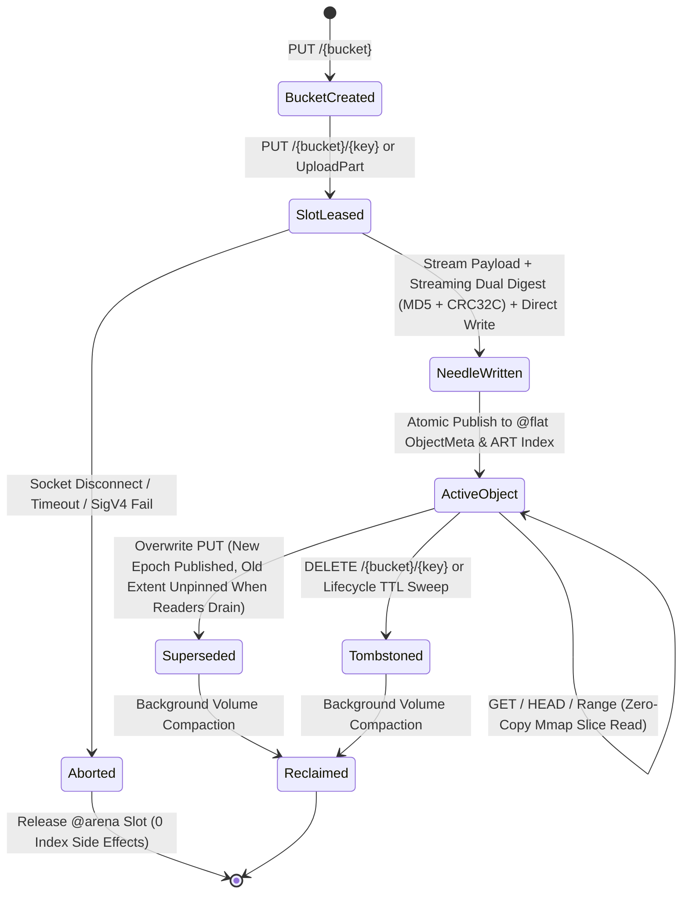

# Awan Storage Architecture Specification

> **Engine Internals: Columnar Memory Model, Sparse Virtual Volumes, Staged Multipart Extents, MVCC Lifecycle, and Kernel I/O**

---

## 1. Architectural Invariants

Awan Storage is built on six non-negotiable systems engineering invariants:
1. **Zero Dynamic Allocation on the Hot Path:** Every network packet, HTTP header, chunk buffer, and metadata record operates within preallocated `@arena` slabs and bounded LRU caches (<= 16 MiB) initialized at startup.
2. **Columnar Metadata Layout (`@flat`):** All object metadata is lowered automatically into contiguous primitive arrays (Struct-of-Arrays) paired with an append-only Key String Arena and an Adaptive Radix Tree (ART) prefix index.
3. **32 GiB Sparse Virtual Volume Pre-Allocation (`FSCTL_SET_SPARSE`):** Volumes are initialized as 32 GiB virtual sparse files (`FSCTL_SET_SPARSE` on Windows NTFS, sparse holes on Linux) without allocating physical disk clusters upfront. They are mapped once at startup via `memmap2::Mmap` (`open_sparse`), completely eliminating runtime `remap()` latency stalls, page table invalidation, and reader lock serialization.
4. **Staged Parallel Part Files for Multipart Uploads:** Parts upload to independent file handles under `.staging/<upload-id>/part_<num>.dat`, eliminating Windows kernel `FO_SYNCHRONOUS_IO` lock serialization across parallel multipart workers.
5. **Zero-Copy Kernel Handoff & Direct Extent Slicing:** Range GETs directly slice memory-mapped volume and part extents via `Bytes::from_owner(MmapOwner(mmap)).slice(...)`, bypassing heap allocations and disk read syscalls.
6. **Deterministic Shard Ownership & Lock-Free MVCC Reads:** The metadata index is partitioned into $S$ cache-line-aligned shards by keyed hash. Point reads execute lock-free via optimistic epoch/seqlock pins, ensuring in-flight `GET` streams never observe torn writes during concurrent `PUT` overwrites.

---

## 2. Memory Model & Data Structures

```
┌──────────────────────────────────────────────────────────────────────────────────────────┐
│                                   NODE MEMORY ARENA                                      │
│                                                                                          │
│  ┌────────────────────────────────────┐   ┌────────────────────────────────────────────┐ │
│  │   1. @flat ObjectMeta SoA Table    │   │   2. Key String Arena & Prefix ART Index   │ │
│  ├────────────────────────────────────┤   ├────────────────────────────────────────────┤ │
│  │ key_hash:     [u64; 10M] (XXH3)    │   │ key_bytes: "models/llama3/shard_01.bin..." │ │
│  │ bucket_flags: [u64; 10M]           │   │ Radix Tree: lexicographical prefix lookup  │ │
│  │ vol_offset:   [u64; 10M]           │   └────────────────────────────────────────────┘ │
│  │ size:         [u64; 10M]           │   ┌────────────────────────────────────────────┐ │
│  │ etag_hi:      [u64; 10M] (MD5 hi)  │   │   3. @flat PartExtent Table (Multipart)    │ │
│  │ etag_lo:      [u64; 10M] (MD5 lo)  │   ├────────────────────────────────────────────┤ │
│  │ created_at:   [u64; 10M] (ns)      │   │ vol_offset: [u64; 2M], part_size: [u64; 2M]│ │
│  │ key_slice:    [u64; 10M] (off+len) │   │ etag_hi:    [u64; 2M], etag_lo:   [u64; 2M]│ │
│  └────────────────────────────────────┘   └────────────────────────────────────────────┘ │
│                                                                                          │
│  ┌─────────────────────────────────────────────────────────────────────────────────────┐ │
│  │   4. 32 GiB Sparse Virtual Mmap & Staged MPU Mmap Extent Slices                     │ │
│  │   Direct zero-copy slicing: Bytes::from_owner(MmapOwner(mmap)).slice(start..end)   │ │
│  └──────────────────────────────────────────┬──────────────────────────────────────────┘ │
└─────────────────────────────────────────────┼────────────────────────────────────────────┘
                                              │ Zero-Copy DMA (O_DIRECT / Mmap Slice)
                                              ▼
                               ┌───────────────────────────────┐
                               │   NVMe Volume Slabs & NIC     │
                               │  Linux io_uring / Win IOCP    │
                               └───────────────────────────────┘
```

### A. The `@flat ObjectMeta` Columnar Index (64 Bytes / Object)
```awan
@flat
struct ObjectMeta {
    key_hash: Int,      // 64-bit keyed XXH3 / SipHash-1-3 of (bucket_id, key_bytes)
    bucket_flags: Int,  // High 32b: bucket_id | Low 16b: part_count | Low 16b: status flags
    vol_offset: Int,    // High 16b: volume_id | Low 48b: 4KB-aligned offset (or PartExtent index)
    size: Int,          // Total object payload size in bytes
    etag_hi: Int,       // Upper 64 bits of 128-bit MD5 / checksum digest
    etag_lo: Int,       // Lower 64 bits of 128-bit MD5 / checksum digest
    created_at: Int,    // Unix epoch timestamp in milliseconds / nanoseconds
    key_slice: Int      // High 48b: byte offset in Key String Arena | Low 16b: key byte length
}
```
- **Why Full 128-Bit ETag (`etag_hi`, `etag_lo`) + `part_count`:** Standard S3 clients (`aws-cli`, `boto3`, `rclone`, `warp`) validate the returned `ETag` against the full 32-character hex MD5 digest (e.g., `"d41d8cd98f00b204e9800998ecf8427e"`) for single-part objects and `"<32-hex-md5>-<part_count>"` for multipart objects. Storing both 64-bit halves preserves 100% S3 wire fidelity with zero string heap allocation.
- **Why `key_slice` into Key String Arena:** A 64-bit hash alone is one-way and cannot reconstruct `<Key>` strings for `ListObjectsV2` XML responses or verify full key equality upon hash collision. Storing `(arena_offset, key_len)` resolves collisions deterministically and enables zero-copy XML emission.
- **Status Flags (`bucket_flags` low 16 bits):**
  - `0x0001` (`FLAG_ACTIVE`): Live committed object.
  - `0x0002` (`FLAG_TOMBSTONE`): Deleted object awaiting background compaction.
  - `0x0004` (`FLAG_MULTIPART`): `vol_offset` points to a contiguous range of `part_count` entries in the `@flat PartExtent` table.
  - `0x0008` (`FLAG_SHARED_REF`): Object shares underlying extents via `x-amz-copy-source` (ref-counted).
  - `0x0010` (`FLAG_ZERO_BYTE`): `size == 0`; no volume slab extent leased.

### B. Prefix Index for `ListObjectsV2` (Sorted Eytzinger / Adaptive Radix Tree)
AWS S3 `ListObjectsV2` mandates that keys matching `prefix` and `delimiter` be returned in **UTF-8 binary lexicographical order**. Because hash values are not order-preserving:
- Each bucket maintains an **Adaptive Radix Tree (ART)** (or per-bucket sorted key-slice array with an 8-byte inline ASCII key prefix cache) mapping key paths to their `@flat ObjectMeta` row index.
- Prefix queries (`prefix="datasets/2026/"`, `delimiter="/"`) jump directly to the subtree node in $O(|prefix|)$ time, yielding lexicographically ordered keys and `CommonPrefixes` in microseconds without scanning unrelated objects.

### C. Zero-Copy Multipart & Clone Extent Table (`@flat PartExtent`)
When a large object ($> 5\text{ MiB}$) is uploaded in $P$ parallel multipart streams, parts arrive out of order and land at non-contiguous offsets across volume slabs or staging part files.
- On `CompleteMultipartUpload`, the engine allocates $P$ contiguous rows in `@flat PartExtent`:
  ```awan
  @flat
  struct PartExtent {
      vol_offset: Int,    // High 16b: volume_id | Low 48b: byte offset in volume
      part_size: Int,     // Byte length of this part
      cumulative_end: Int,// Prefix-sum end offset within logical object (for O(log P) Range lookup)
      ref_count: Int      // Reference count for x-amz-copy-source and MVCC reader pins
  }
  ```
- **Zero-Copy Direct Extent Slicing:** A `GET` with `Range: bytes=start-end` binary-searches `cumulative_end` in $O(\log P)$ time and slices directly from memory-mapped parts via `Bytes::from_owner(MmapOwner(mmap)).slice(...)` without disk read syscalls or heap copies.

---

## 3. On-Disk Storage Layout: WORM Needle Volumes & Crash Recovery

```
┌──────────────────────────────────────────────────────────────────────────────────────────┐
│                         VOLUME SLAB FILE (volume_0001.dat - 32 GiB Sparse)               │
├──────────────────────┬───────────────────────────────────────────┬───────────────────────┤
│ Volume Superblock    │ Needle 0 (4096B Aligned)                  │ Needle 1 (4096B) ...  │
│ (4096 Bytes)         │ [Header 64B][Key Bytes][Payload][Padding] │ [Header 64B][...]     │
└──────────────────────┴───────────────────────────────────────────┴───────────────────────┘
```

### A. Needle Record Format (4096-Byte Sector Aligned for Direct I/O)
Each object or multipart segment written to a Volume Slab is encapsulated in a self-describing **Needle**:
- `magic: u32` (`0x41574E33` = `"AWN3"`)
- `header_crc32c: u32` (Castagnoli CRC32C of header fields)
- `payload_crc32c: u32` (Castagnoli CRC32C of payload bytes for background bitrot scrubbing)
- `flags: u16`, `bucket_id: u16`, `key_len: u16`, `reserved: u16`
- `key_hash: u64`
- `payload_size: u64`
- `created_at_ns: u64`
- `etag_hi: u64`, `etag_lo: u64`
- Followed by `key_bytes` (`key_len` bytes), `payload_bytes` (`payload_size` bytes), and zero-padding to the next 4096-byte boundary.

### B. 32 GiB Sparse Pre-Allocation, Durability Modes & Crash Recovery
1. **32 GiB Sparse Pre-Allocation (`FSCTL_SET_SPARSE`):**
   - Volume `.dat` files are pre-allocated with a 32 GiB virtual size using `FSCTL_SET_SPARSE` on Windows NTFS and `fallocate` sparse holes on Linux.
   - Physical disk blocks are allocated on-demand by the filesystem as sequential needles are written; unwritten regions consume zero physical bytes.
   - The entire 32 GiB virtual span is mapped once into the server address space via `memmap2::Mmap` at startup (`VolumeManager::open_sparse`), eliminating `Mmap::map` remap stalls and lock contention under high-concurrency mixed traffic.
2. **Staged Parallel Part Files for Multipart Uploads:**
   - In-flight multipart parts are written to independent file handles under `.staging/<upload-id>/part_<num>.dat`, eliminating kernel lock serialization.
   - Upon `CompleteMultipartUpload`, staged parts are appended sequentially into the sparse volume, journaled into `.idx`, and the staging directory is cleaned up.
3. **Crash Recovery over Sparse Volumes:**
   - On startup, the recovery scanner replays `.idx` journals and scans the sparse volume sequentially.
   - When encountering unwritten sparse virtual space (where `magic != NEEDLE_MAGIC` or CRC fails), the recovery scan halts cleanly at the last verified 4096-byte boundary. Uncommitted writes never appear in the index.
4. **Background Compaction (Reclaiming Tombstones):**
   - When dead space from `DELETE` or overwritten keys exceeds $30\%$, the background compactor copies still-live needles into a new volume, atomically CAS-updates `vol_offset` in `@flat ObjectMeta`, and unlinks the old volume file.

---

## 4. End-to-End Object Lifecycle & Concurrency Flow



---

## 5. Kernel I/O Substrate & Hardware Crypto

1. **Linux: `io_uring` with Registered Buffers (`IORING_REGISTER_BUFFERS`) + `O_DIRECT`:**
   - Memory slabs are registered with the kernel once at startup; socket reads and NVMe writes execute without page-table remapping.
2. **Windows: I/O Completion Ports (IOCP) + `FILE_FLAG_NO_BUFFERING` & `FSCTL_SET_SPARSE`:**
   - Sector-aligned buffers with sparse direct device controls.
3. **Hardware-Accelerated Dual Checksum Pipeline (`StreamingDigest`):**
   - **Real-Time Dual Hashing:** MD5 (wire ETag) and Castagnoli CRC32C (needle verification) compute concurrently in registers as TCP frames arrive over the wire.
   - **Hardware Dispatch:** SSE4.2 CRC32C and AVX2 crypto instructions execute when supported by the CPU (`is_x86_feature_detected!("sse4.2")`).
   - **Bit-Identical Software Fallback:** Systems without SSE4.2/AVX2 automatically use a 256-entry software Castagnoli lookup table, ensuring 100% bit-identical digests across non-SIMD hypervisors and ARM platforms.
   - **SigV4 Acceleration:** Intel SHA-NI / ARMv8 Crypto extensions (`> 3.5 GB/s` per core) plus per-day derived `kSigning` key cache.
