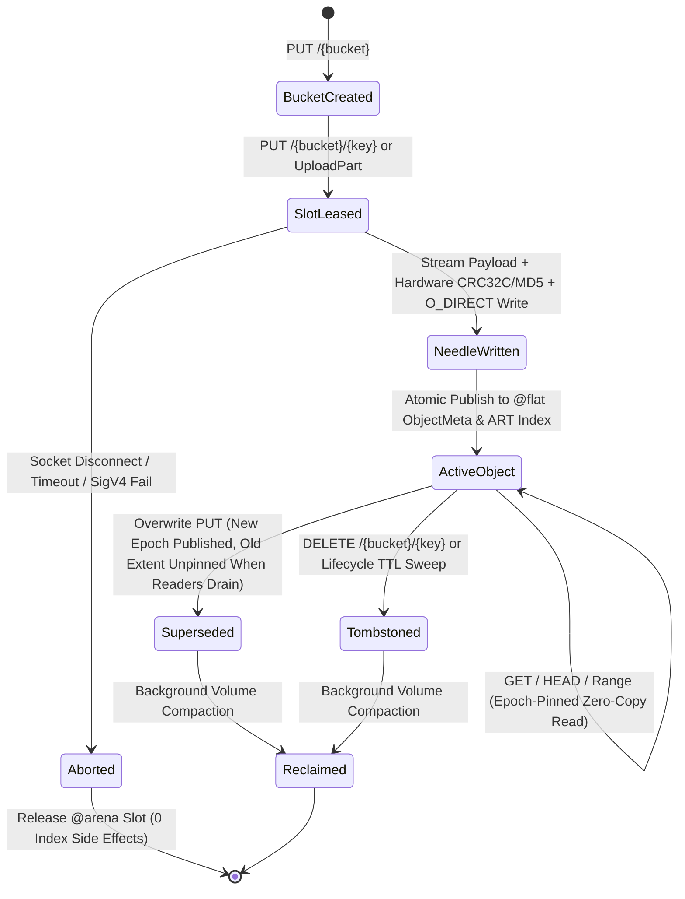

# Awan Storage Architecture Specification

> **Engine Internals: Columnar Memory Model, Needle Volume Layout, MVCC Lifecycle, and Kernel I/O**

---

## 1. Architectural Invariants

Awan Storage is built on five non-negotiable systems engineering invariants:
1. **Zero Dynamic Allocation on the Hot Path:** Every network packet, HTTP header, chunk buffer, and metadata record operates within preallocated `@arena` slabs initialized at startup.
2. **Columnar Metadata Layout (`@flat`):** All object metadata is lowered automatically into contiguous primitive arrays (Struct-of-Arrays) paired with an append-only Key String Arena and an Adaptive Radix Tree (ART) prefix index.
3. **WORM Needle Volume Packing with Direct I/O (`O_DIRECT`):** Objects are never stored as individual host filesystem files. Payloads pack sequentially into 32 GiB preallocated volume files (`volume_0001.dat`) using 4096-byte aligned Direct I/O, bypassing OS PageCache double-buffering and inode exhaustion.
4. **Zero-Copy Kernel Handoff & Extent Linking:** Socket buffers are pinned and passed directly to NVMe controllers or client sockets via completion rings. Multipart uploads and server-side copies (`x-amz-copy-source`) link chunk extents by reference without copying payload bytes.
5. **Deterministic Shard Ownership & Lock-Free MVCC Reads:** The metadata index is partitioned into $S$ cache-line-aligned shards by keyed hash. Point reads execute lock-free via optimistic epoch/seqlock pins, ensuring in-flight `GET` streams never observe torn writes during concurrent `PUT` overwrites.

---

## 2. Memory Model & Data Structures

```
┌──────────────────────────────────────────────────────────────────────────────────────────┐
│                                   NODE MEMORY ARENA                                      │
│                                                                                          │
│  ┌────────────────────────────────────┐   ┌────────────────────────────────────────────┐ │
│  │   1. @flat ObjectMeta SoA Table    │   │   2. Key String Arena & Prefix ART Index   │ │
│  ├────────────────────────────────────┤   ├────────────────────────────────────────────┤ │
│  │ key_hash:     [u64; 10M] (XXH3)    │   │ key_bytes: "models/llama3/shard_01.bin..." │ │
│  │ bucket_flags: [u64; 10M]           │   │ Radix Tree: lexicographical prefix lookup  │ │
│  │ vol_offset:   [u64; 10M]           │   └────────────────────────────────────────────┘ │
│  │ size:         [u64; 10M]           │   ┌────────────────────────────────────────────┐ │
│  │ etag_hi:      [u64; 10M] (MD5 hi)  │   │   3. @flat PartExtent Table (Multipart)    │ │
│  │ etag_lo:      [u64; 10M] (MD5 lo)  │   ├────────────────────────────────────────────┤ │
│  │ created_at:   [u64; 10M] (ns)      │   │ vol_offset: [u64; 2M], part_size: [u64; 2M]│ │
│  │ key_slice:    [u64; 10M] (off+len) │   │ etag_hi:    [u64; 2M], etag_lo:   [u64; 2M]│ │
│  └────────────────────────────────────┘   └────────────────────────────────────────────┘ │
│                                                                                          │
│  ┌─────────────────────────────────────────────────────────────────────────────────────┐ │
│  │   4. Pinned Chunk Ring Slabs (@arena, 4096-Byte Page Aligned for O_DIRECT)          │ │
│  │   Slot 0: [u8; 65536] │ Slot 1: [u8; 65536] │ ... │ Slot N: [u8; 65536] (Pinned)    │ │
│  └──────────────────────────────────────────┬──────────────────────────────────────────┘ │
└─────────────────────────────────────────────┼────────────────────────────────────────────┘
                                              │ Zero-Copy DMA (O_DIRECT / Registered Ring)
                                              ▼
                               ┌───────────────────────────────┐
                               │   NVMe Volume Slabs & NIC     │
                               │  Linux io_uring / Win IOCP    │
                               └───────────────────────────────┘
```

### A. The `@flat ObjectMeta` Columnar Index (64 Bytes / Object)
```awan
@flat
struct ObjectMeta {
    key_hash: Int,      // 64-bit keyed XXH3 / SipHash-1-3 of (bucket_id, key_bytes)
    bucket_flags: Int,  // High 32b: bucket_id | Low 16b: part_count | Low 16b: status flags
    vol_offset: Int,    // High 16b: volume_id | Low 48b: 4KB-aligned offset (or PartExtent index)
    size: Int,          // Total object payload size in bytes
    etag_hi: Int,       // Upper 64 bits of 128-bit MD5 / checksum digest
    etag_lo: Int,       // Lower 64 bits of 128-bit MD5 / checksum digest
    created_at: Int,    // Unix epoch timestamp in milliseconds / nanoseconds
    key_slice: Int      // High 48b: byte offset in Key String Arena | Low 16b: key byte length
}
```
- **Why Full 128-Bit ETag (`etag_hi`, `etag_lo`) + `part_count`:** Standard S3 clients (`aws-cli`, `boto3`, `rclone`, `warp`) validate the returned `ETag` against the full 32-character hex MD5 digest (e.g., `"d41d8cd98f00b204e9800998ecf8427e"`) for single-part objects and `"<32-hex-md5>-<part_count>"` for multipart objects. Storing both 64-bit halves preserves 100% S3 wire fidelity with zero string heap allocation.
- **Why `key_slice` into Key String Arena:** A 64-bit hash alone is one-way and cannot reconstruct `<Key>` strings for `ListObjectsV2` XML responses or verify full key equality upon hash collision. Storing `(arena_offset, key_len)` resolves collisions deterministically and enables zero-copy XML emission.
- **Status Flags (`bucket_flags` low 16 bits):**
  - `0x0001` (`FLAG_ACTIVE`): Live committed object.
  - `0x0002` (`FLAG_TOMBSTONE`): Deleted object awaiting background compaction.
  - `0x0004` (`FLAG_MULTIPART`): `vol_offset` points to a contiguous range of `part_count` entries in the `@flat PartExtent` table.
  - `0x0008` (`FLAG_SHARED_REF`): Object shares underlying extents via `x-amz-copy-source` (ref-counted).
  - `0x0010` (`FLAG_ZERO_BYTE`): `size == 0`; no volume slab extent leased.

### B. Prefix Index for `ListObjectsV2` (Sorted Eytzinger / Adaptive Radix Tree)
AWS S3 `ListObjectsV2` mandates that keys matching `prefix` and `delimiter` be returned in **UTF-8 binary lexicographical order**. Because hash values are not order-preserving:
- Each bucket maintains an **Adaptive Radix Tree (ART)** (or per-bucket sorted key-slice array with an 8-byte inline ASCII key prefix cache) mapping key paths to their `@flat ObjectMeta` row index.
- Prefix queries (`prefix="datasets/2026/"`, `delimiter="/"`) jump directly to the subtree node in $O(|prefix|)$ time, yielding lexicographically ordered keys and `CommonPrefixes` in microseconds without scanning unrelated objects.

### C. Zero-Copy Multipart & Clone Extent Table (`@flat PartExtent`)
When a large object ($> 5\text{ MiB}$) is uploaded in $P$ parallel multipart streams, parts arrive out of order and land at non-contiguous offsets across volume slabs.
- On `CompleteMultipartUpload`, the engine allocates $P$ contiguous rows in `@flat PartExtent`:
  ```awan
  @flat
  struct PartExtent {
      vol_offset: Int,    // High 16b: volume_id | Low 48b: byte offset in volume
      part_size: Int,     // Byte length of this part
      cumulative_end: Int,// Prefix-sum end offset within logical object (for O(log P) Range lookup)
      ref_count: Int      // Reference count for x-amz-copy-source and MVCC reader pins
  }
  ```
- **Zero-Copy Completion:** `CompleteMultipartUpload` links the parts in $< 5\text{ µs}$ without copying a single payload byte on disk.
- **Fast Byte-Range Reads over Multipart Objects:** A `GET` with `Range: bytes=start-end` binary-searches `cumulative_end` in $O(\log P)$ time and streams the exact intersecting part slices directly to the socket.

---

## 3. On-Disk Storage Layout: WORM Needle Volumes & Crash Recovery

```
┌──────────────────────────────────────────────────────────────────────────────────────────┐
│                         VOLUME SLAB FILE (volume_0001.dat - 32 GiB)                      │
├──────────────────────┬───────────────────────────────────────────┬───────────────────────┤
│ Volume Superblock    │ Needle 0 (4096B Aligned)                  │ Needle 1 (4096B) ...  │
│ (4096 Bytes)         │ [Header 64B][Key Bytes][Payload][Padding] │ [Header 64B][...]     │
└──────────────────────┴───────────────────────────────────────────┴───────────────────────┘
```

### A. Needle Record Format (4096-Byte Sector Aligned for `O_DIRECT`)
Each object or multipart segment written to a Volume Slab is encapsulated in a self-describing **Needle**:
- `magic: u32` (`0x41574E33` = `"AWN3"`)
- `header_crc32c: u32` (Castagnoli CRC32C of header fields)
- `payload_crc32c: u32` (Castagnoli CRC32C of payload bytes for background bitrot scrubbing)
- `flags: u16`, `bucket_id: u16`, `key_len: u16`, `reserved: u16`
- `key_hash: u64`
- `payload_size: u64`
- `created_at_ns: u64`
- `etag_hi: u64`, `etag_lo: u64`
- Followed by `key_bytes` (`key_len` bytes), `payload_bytes` (`payload_size` bytes), and zero-padding to the next 4096-byte boundary.

### B. Crash Recovery & Persistence Lifecycle
1. **Write Path:**
   - Payload streams into 4096-byte aligned `@arena` slots while hardware CRC32C/MD5/SHA256 computes in register.
   - Needle is written via `O_DIRECT` positional write to the active volume slab (`volume_XXXX.dat`), and a compact 64-byte index entry is appended to the volume's `.idx` journal file.
   - Only after the write completes is the row atomically published into `@flat ObjectMeta`.
2. **Startup & Crash Replay:**
   - On startup, the daemon memory-maps the latest `metadata.checkpoint` snapshot into the `@flat ObjectMeta` columns and replays any subsequent entries from `.idx`.
   - If the node suffered an unclean power loss mid-write, the tail of the active volume file is scanned: any torn needle whose `magic` or `payload_crc32c` fails verification is truncated to the last valid 4096-byte boundary. Uncommitted writes never appear in the index.
3. **Background Compaction (Reclaiming Tombstones):**
   - When a sealed volume's dead space (from `DELETE`, lifecycle TTL expiration, or overwritten keys) exceeds $30\%$, the background compactor copies still-live needles into a new volume, atomically CAS-updates their `vol_offset` in `@flat ObjectMeta` (waiting for any active MVCC reader epoch to drain), and unlinks the old volume file.

---

## 4. End-to-End Object Lifecycle & Concurrency Flow



---

## 5. Kernel I/O Substrate & Hardware Crypto

1. **Linux: `io_uring` with Registered Buffers (`IORING_REGISTER_BUFFERS`) + `O_DIRECT`:**
   - Memory slabs are registered with the kernel once at startup; socket reads and NVMe writes execute without page-table remapping.
2. **Windows: I/O Completion Ports (IOCP) + `FILE_FLAG_NO_BUFFERING`:**
   - Uses preallocated 4096-byte aligned slabs with asynchronous overlapped completion ports.
3. **Hardware-Accelerated Integrity:**
   - **AWS SigV4 & Payload SHA-256:** Intel SHA-NI / ARMv8 Crypto extensions (`> 3.5 GB/s` per core) plus per-day derived `kSigning` key cache.
   - **ETag & Scrubbing Checksums:** SIMD MD5 and hardware SSE4.2 / ARMv8 Castagnoli `crc32c`.
