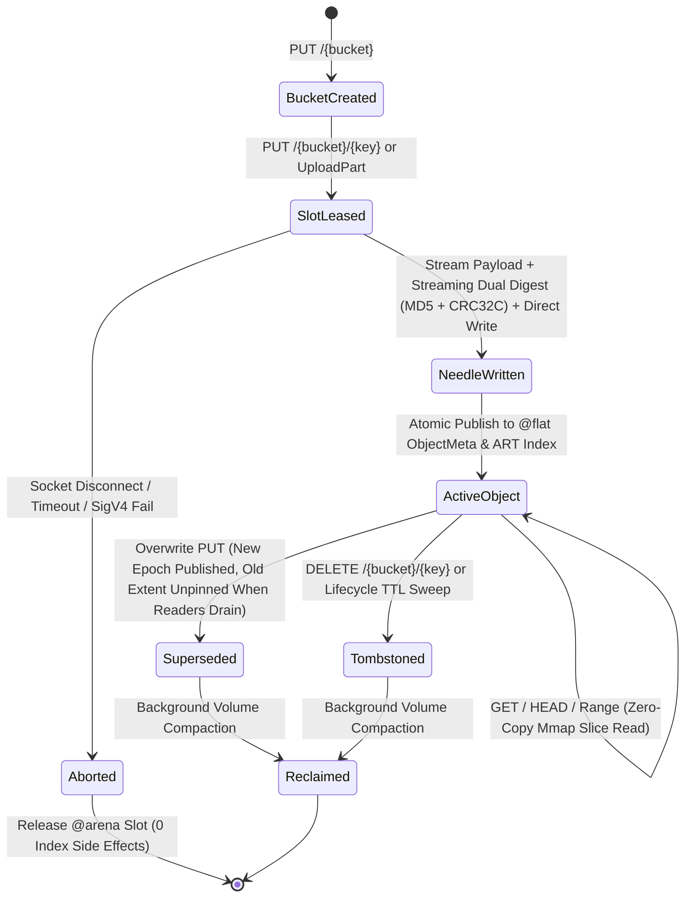

# Awan Storage Architecture Specification

> **Engine Internals: Columnar Memory Model, Sparse Virtual Volumes, Staged Multipart Extents, MVCC Lifecycle, and Kernel I/O**

---

## 0. Decisions (2026-11-12)

Owner decisions after the 2026-11-12 audit. The milestones Phase 1-4 on GitHub carry the issues; [`ROADMAP_AND_DEPENDENCIES.md`](ROADMAP_AND_DEPENDENCIES.md) shows the order.

| # | Decision | Issues |
|---|---|---|
| 1 | **Durability:** group commit is the default (a 200 means the bytes are on stable storage). `--durability=fast` (background flush at least once a second; a power cut loses at most about the last second) and `--durability=strict` (sync each write) are opt-in. Reason: AwanFS is single-node; servers that skip fsync by default (Garage, SeaweedFS) keep copies on other nodes. Recovery must not stop at a gap first. | #29, #38 |
| 2 | **Authentication:** bind 127.0.0.1 by default; verify SigV4 against keys from the environment; anonymous access only behind an explicit flag. IAM policies and TLS follow as separate issues. | #35, #53, #30 |
| 3 | **Performance gates:** no absolute MiB/s targets. Layer 1: exact work counts per request type in `server/tests/work_count_test.rs` (every PR, both platforms). Layer 2: nightly AwanFS/MinIO throughput ratio on the same runner (`benchmarks/ratio_check.py`, baseline `benchmarks/ratio_baseline.json`). | #33, #34 |
| 4 | **Order:** correctness and security first (Phase 1), then production operations (Phase 2), then scale and efficiency (Phase 3), multi-node last (Phase 4). | milestones |
| 5 | **Topology:** single node; operators use RAID or ZFS for disk failure. Multi-node clustering is a design issue for when a production deployment needs high availability; `libs/awan-cluster` from awan-lang is an input to the design, not code to port. Superseded by decision 64 once #26 lands. | #52, #27, #15 |
| 6 | **Metadata:** keep the redb spill index; review it with the tiered metadata and Bloom filter work after Phase 1 (which reads its segments with positioned reads: decision 58). Superseded by decision 59. | #13, #26, #207 |
| 7 | **Compression:** opt-in per bucket, in independent 64 KiB blocks so range GETs stay cheap; off by default. | #51 |
| 8 | **Observability:** structured logs with request IDs, Prometheus `/metrics`, OpenTelemetry traces, health endpoints, a Grafana dashboard and alert rules, and an S3 access log. | #41-#46 |

### Decisions (2026-11-13)

Owner decisions after the 2026-11-12 unattended run (#64-#83), each the recommended option.

| # | Decision | Issues |
|---|---|---|
| 9 | **Admin endpoints** live under `/_awanfs/` (`health/live`, `health/ready`, `metrics`), unauthenticated. `_` is not allowed in bucket names, so they never shadow a bucket. A separate admin port may follow if metrics must stay off the public port. | #44, #42 |
| 10 | **Ratio baseline:** the PUT rows are re-recorded from the lowest ratio of about five nightly runs with group durability, not from one run. | #34, #29 |
| 11 | **Logging:** the hand-written JSON request line stays until #43; tracing and tracing-subscriber come with OpenTelemetry, with the same field names. | #41, #43 |
| 12 | **Configuration:** flags and `AWANFS_*` variables for now; a TOML file comes with IAM. | #49, #53 |
| 13 | **Disk-space alerting:** no "volume above 85 %" alert, because a full volume rolls over (#37); free space comes from node_exporter. | #45 |
| 14 | **aws-chunked bodies:** every chunk's signature is verified (next Phase 1 item), not left to TLS. | #35, #30 |
| 15 | **Compaction:** automatic when the oldest volume is at least 20 % dead space, with a switch to turn it off; manual compaction stays available. | #14 |
| 16 | **Kept as built:** the journal is synced with the volume (2 syncs per lone write); group commit has no fixed batch window; the library default accepts unsigned requests while the binary needs keys or `--allow-anonymous`; bodies above 4 MiB stream to disk; new volumes are not sparse; ready is 503 only when no write can succeed. | #29, #35, #36, #37, #44 |

### Decisions (2026-11-13, second set)

| # | Decision | Issues |
|---|---|---|
| 17 | **New crates** reach Cargo.lock through a manual CI workflow that runs `cargo update` and opens a PR; CI keeps `--locked`. | all |
| 18 | **TLS:** `--cert`/`--key` with rustls; files reloaded when they change (checked every 60 s) and on SIGHUP; plain HTTP off when a certificate is set unless `--http-port`. No ACME. | #30 |
| 19 | **IAM:** a subset of AWS policy JSON (Effect, Action `s3:*`, Resource `arn:aws:s3:::bucket/prefix*`), one policy per key, in a 0600 config file reloaded on change; no admin API yet. | #53 |
| 20 | **On-disk format:** refuse a newer version; read older versions as they are; write new volumes in the new format. No in-place upgrade. | #50 |
| 21 | **Versioning** after #50 and #53. | #31 |
| 22 | **Compression:** zstd level 1, enabled per bucket in the TOML config. | #51 |
| 23 | **Metadata scale:** close #13 if the redb spill meets its gate; #26 waits as `unmeasured` until a deployment needs over 100M objects. Superseded by decision 59: #207 measured it (go, owner 2026-11-16), and #26 is built to replace the redb spill. | #13, #26, #207 |
| 24 | **Compaction I/O:** token-bucket limit (50 MB/s, configurable); copy-on-write cloning only after a measurement. | #28 |
| 25 | **Multi-node:** #15 closed as a duplicate of #27; the #52 design note after Phase 2; no code yet. The note is approved (decision 64); cluster code starts after #26. | #15, #27, #52 |
| 26 | **Benchmark hardware:** the owner's machine as a self-hosted runner (`benchmarks/RUNNER.md`); paid runners only for published numbers. | #58 |
| 27 | **Invalid ranges** (`bytes=5-3`): whatever ceph s3-tests expects, once #47 runs. | #47 |

### Decisions (2026-11-13, third set: CI without hosted runners)

| # | Decision | Issues |
|---|---|---|
| 28 | **#96 and #97 stay merged.** They went in while hosted jobs could not start (billing); the Linux try run of the stack confirms them. | #96, #97 |
| 29 | **The merge gate while hosted CI is down:** `try/*` runs on the owner's self-hosted Windows and Linux runners, with their output (suite and negative control) posted on the PR. | all PRs |
| 30 | **Hosted Actions:** fix the payment and set a monthly cap. | CI |
| 31 | **The Linux runner installs its own Rust** (`dtolnay/rust-toolchain` in the user's home). System packages (`build-essential`) are the owner's. | CI |
| 32 | **#28's gate** becomes "throttle_test passes and compaction_safety_test is unchanged"; copy-on-write cloning moves to its own `unmeasured` issue. | #28 |
| 33 | **Benchmarks run on the owner's laptop** (Windows runner and `awanfs-bench`) through try runs, one job at a time; the numbers track changes, they are not for publication (#58). | #23, #36, #57, #58 |
| 34 | **Branch clean-up** is the owner's, in one pass after the open PRs merge. | — |

### Decisions (2026-11-13, fourth set: public repository)

| # | Decision | Issues |
|---|---|---|
| 35 | **The repository is public (Apache-2.0); CI runs on GitHub-hosted runners only.** The self-hosted runners serve one workflow, `bench-selfhosted.yml`, for benchmarks that need more than 8 cores. Supersedes 29 (hosted CI is the merge gate again), 30 (public repositories have free minutes) and 33 (benchmarks run hosted unless they need more than 8 cores). Fork pull-request workflows need approval for every external contributor (`benchmarks/RUNNER.md`). | all PRs, #58 |

### Decisions (2026-11-13, fifth set: next work and S3 feature scope)

| # | Decision | Issues |
|---|---|---|
| 36 | **Memory plan first:** one `--memory-budget`; a cap on request bytes held in memory (enforced since #128: bodies are admitted against their half of the budget, 503 `SlowDown` after a 100 ms wait); the nightly ratio run enforces an RSS ceiling. Conformance quick wins (#111-#114) come after. | #57, #111-#114 |
| 37 | **Object lock: governance and compliance modes, plus legal hold**, as S3 defines them, on top of versioning (#31). | #120 |
| 38 | **Encryption: SSE-S3 with a local master key that wraps per-object keys, and SSE-C;** SSE-KMS first from a local key file of named keys (decision 49, 2026-11-14, replacing "through an external service later"); an external KMS can replace the file without a format change. | #121 |
| 39 | **Access: bucket policies (on the #53 evaluator), canned ACLs, per-grantee ACL grants and the public access block.** Per-grantee grants were ruled out here at first and allowed by decision 48 (2026-11-14); new buckets have ACLs off. | #122 |

**Decision 40 (2026-11-13): `--allow-anonymous` is refused together with users in `--config`.**
Policies are checked for `Principal::User` only, so an unsigned request accepted by
`--allow-anonymous` would get more access than any user the config restricts. The server exits 2
and names both flags. `--allow-anonymous` on its own is unchanged: the startup message already
says anyone who can reach the port can read, write and delete. A config that sets only
`[[buckets]]` restricts nobody, so it is not the combination. The policy model for public access
is #122 (decision 39), which replaces this guard when it lands. Found by an adversarial review of
#53, filed as #130.

**Decision 43 (2026-11-14): volume format 3 stores object attributes in the needle.** The
reserved header bytes 18..20 become the length of an attributes block between the key and the
payload; tags, ACLs, retention and legal hold change later through attribute-update needles
(flag 0x200) replayed in creation-time order. Format 2 needles are valid format 3 needles and
are never rewritten. Chosen over a separate attribute database, which would be a second source
of truth for recovery, compaction and replication. `CONFORMANCE_DESIGN.md` section 4, #150.

**Decision 44 (2026-11-14): accounts and owners are enforced.** Each user in the users file is
its own account unless it names one; a bucket belongs to the account that created it, an object
to its writer. One function decides every request, and an identity policy reaches only the
caller's own account's resources: another account's bucket needs a bucket policy or an ACL
grant. Setups with only the root key do not change. `CONFORMANCE_DESIGN.md` section 5, #151.

**Decision 45 (2026-11-14): the conformance target is the ceph s3-tests suite without its
RGW-only tests and without storage classes or cloud tiering.** Bucket logging is built last, and
whether it is built at all is decided after object lock, encryption and lifecycle are done.
`CONFORMANCE_DESIGN.md` section 9, #123, #153.

**Decision 46 (2026-11-14): objects above 4 MiB are streamed, and verified as they stream.** A
full GET computes the payload checksum while it sends and aborts the connection on a mismatch; a
range GET is not verified, and a background scrub checks whole objects. Today every GET or range
checksums the whole object before the first byte (measured: 20.7 ms to headers and 29.6 ms per
1 MiB range at 256 MiB, 4.4 GiB of resident file pages; `measurements/2026-11-14-large-objects.md`).
Per-block checksums, which would verify ranges, were not chosen now. #155.
Step one (PR #169) checksums a full GET while it is sent and leaves ranges unchecked: time to
headers is 0.4 ms and a 1 MiB range 1.6 ms at 16, 64 and 256 MiB
(`measurements/2026-11-14-large-objects-after-155-step1.md`). Step two (PR #202) reads objects
above 4 MiB with positioned reads outside the mapping (`server/src/stream_read.rs`): peak RSS
370.5 MiB against 1464.7 MiB, with every GET row above MinIO's: first GET 2.05-2.35x, repeat
GETs with 4 clients 1.21-1.38x (runs 43736773027 and 43722345701,
`measurements/2026-11-16-large-objects-155-step2.md`). The win was reusing read buffers. Reads
go through the page cache by default: direct reads were slower at every size measured, up to
256 MiB, so `AWAN_DIRECT_READ_MIN` is off until a larger size shows it helps (owner decision
1C keeps the setting). The scrub is still to build.

**Decision 47 (2026-11-14): the conformance target is S3 behaviour only.** It is `test_s3.py`
and `test_headers.py` of the ceph suite, without the RGW-only tests and storage classes
(decision 45). The suite's IAM, STS, S3 Select, SNS and S3 Control files are not part of it.
A 100% target was weighed (`CONFORMANCE_DESIGN.md` section 12): it adds ceph-specific API and a
tiering subsystem. The cheap hooks it would need (a replaceable storage class, bucket usage
counters, a bucket namespace field, commit events) are built in wave 0 anyway. #123, #162, #163,
#164.

**Decision 48 (2026-11-14): per-grantee ACL grants are built, and ACLs are off on new buckets.**
This replaces "no per-grantee ACL grants" in decision 39: most of the suite's ACL tests grant
to a named user. New buckets default to `BucketOwnerEnforced`, as on AWS since 2023, so the
extra surface is opt-in; the suite's profile turns ACLs on (#161). #122, #151.

**Decision 49 (2026-11-14): SSE-KMS starts with a local key file.** Named keys in a file stand
in for a KMS, replacing "through an external service later" in decision 38. The stored form (key
id plus wrapped data key) is what an external KMS would use. #121.

**Decision 50 (2026-11-14): CompleteMultipartUpload rejects parts under 5 MiB, except the
last,** with 400 `EntityTooSmall`, as S3 does. AwanFS accepted any size. The benchmarks move to
5 MiB parts in the same change. #111.

**Decision 51 (2026-11-14): a streamed PUT takes its key's lock only to commit, and is written
again when its key changed meanwhile.** A PUT above 4 MiB held the key lock from before its body
arrived, so a client that stopped sending blocked every other writer of that key (and of the
keys sharing its lock slot). Taking the lock late is unsafe by itself: the needle's offset is
reserved before the body, and recovery replays an unversioned key in offset order
(`verification/tla`, `stream_no_relocate.cfg` fails). So at commit, under the lock, the server
asks whether any needle of the key was appended since the reservation (`StreamsInFlight`), and
if so writes the object again at the end of the log. The cost is one extra copy, only for PUTs
that overlap another write of the same key. Versioned keys are ordered by version id, taken at
commit, and are never copied. Ordering recovery by a commit stamp instead was weighed and not
chosen: it changes a recovery rule for every key and makes it depend on the clock. #154.

**Decision 62 (owner, 2026-11-16, #184 option B): a write whose record is whole in the log
takes effect in the live index even when a later step fails.** Once a needle's header is on
disk, recovery will replay it. If the journal append, the sync, or a streamed PUT's
relocation copy then fails, the request still answers 500 (the outcome is unknown, as S3
allows), but the live index applies the record exactly as recovery will: a PUT, copy,
multipart completion or tag update becomes the object, a delete removes it. So a GET before
and after a restart agree. A failure before the header is written changes nothing. A
streamed PUT whose record failed this way while a later record of its key exists is not
relocated: the later record wins in both. The volume reports such a failure as
`VolumeError::AfterRecord`, carrying the record's location. Not chosen: an abort record or a
commit marker (option A), which changes the volume format. In the model,
`verification/tla/ObjectVersions.tla` has `LateFail` and `RelocateLateFail`:
`fixed_late_fail.cfg` passes, and `late_fail_not_indexed.cfg`, without the fix, breaks
`AckedStateSurvivesRestart`. Recovery stepping over a gap without the journal, which a
record whose journal append failed needs when it sits after a gap, is the next step of #184.

**Decision 63 (owner, 2026-11-17, #186, PR #236): recovery applies an
unversioned record of a key that already has a version history to that key's null version, as
the live index did.** A streamed PUT stamps its version at commit (decision 51), so it can
reserve while the bucket is unversioned and commit versioned after an unversioned write of the
same key that sits later in the log. Live, that write changed the row before the history began.
Recovery met it after the history began and added it as a null version at its own creation
time: the null version's time differed after a restart, and when the clock had stepped back an
unversioned DELETE came out above the versioned PUT the client saw become current. An
unversioned record can only have been stamped while the bucket was unversioned, and a bucket
never returns to unversioned, so such a record always predates the history live. Recovery now
makes a PUT the null version at time 0 (`null_version_of`) and lets a DELETE remove the null
version. No clock reading decides the order. Not chosen: stamping the versioned PUT above every
record noted since its reservation, which fixes the current version only, needs the clock of
each record, and leaves the null version's time different. In the model,
`fixed_versioning.cfg` passes; `versioning_replay_by_time.cfg` breaks
`AckedStateSurvivesRestart` and `versioning_null_time.cfg` breaks `HistorySurvivesRestart`.

**Decision 64 (owner, 2026-11-17, #52): AwanFS clusters by partition leaders that ship their
log to followers, as [`CLUSTERING.md`](CLUSTERING.md) describes.** Each partition of the key space
has a leader and two followers in different racks; followers replay the leader's log with the
recovery code. Raft runs only membership, the partition map and leases, never the request path.
Large objects are erasure-coded when written, above a size threshold that is measured; small
objects are replicated (option B). The availability target is 99.999% of requests per month
(about 26 seconds of failed requests per month), measured per request. Racks in one site come
first; zones later. No cluster code starts before #26 (metadata segments) lands. Not chosen:
erasure sets for every object (MinIO, RustFS), leaderless quorums (Garage).

**Decision 65 (owner, 2026-11-17, #238 option A): a version keeps a display time separate from
its ordering time.** The null version made from an object written before versioning shows that
object's Last-Modified; its ordering time stays 0, so which version is current does not change
and no clock reading decides it (decision 63). Not chosen: giving the null version its real time
as its ordering time and raising the next stamp above it, which reopens the clock-step risk.

**Decision 67 (Claude, 2026-11-19, #213 and #26): a volume reaches its files only through a
file seam, so a seeded simulation can crash and fail them.** `server/src/vfile.rs` defines
`VolFile` (aligned and unaligned positioned writes and reads, length, resize, `sync_data`, sparse,
and the read mapping where there is one) and `VolFs` (open a data file or a journal, exists,
remove). Production uses `DiskFile` and `DiskFs`, which keep today's three handles per file: the
write handle, a second open used only to sync (a Windows sync through the write handle stalls
every writer), and a read-only handle for page-cache reads (#155). `server/src/sim.rs` implements both in memory: a `SimFile` keeps the
bytes made durable by `sync_data` apart from the writes since, so a crash drops them, keeps a
seeded prefix in write order, or tears the next one; faults (`EIO`, `ENOSPC`) are armed by name
per operation. The volume code becomes generic over `VolFs` with `DiskFs` as the default (stage 1b),
so production is monomorphised and pays nothing; #26's segment files and manifest use the same
seam from their first commit. Not covered by the simulation: HTTP, real thread interleavings, and
the mapped read path (`SimFile` has no mapping, so simulated reads use positioned reads; the mapped
path keeps its own tests). Not chosen: a whole-server simulation, and `loom` or `shuttle` for
interleavings (owner, 2026-11-16, option B).

**Decision 68 (Claude, 2026-11-19, #26 stage 5): the metadata segments are leveled.** Flushes
write level-0 segments, which may overlap; each deeper level holds non-overlapping segments and is
about ten times larger than the one above (LevelDB's layout). A lookup reads the level-0 segments
and then at most one segment per level, each behind its key range and Bloom filter, so the cost
of an absent key stays near zero as the store grows, and a prefix scan reads one cursor per
level. Compaction streams: it reads its inputs block by block and writes segments of at most
64 MiB as it goes, so its memory does not grow with the segments. The manifest (format 2,
`FORMAT.md`) records each segment's level; `verification/tla/Levels.tla` checks the three rules
(level 0 compacts whole, every overlapping segment below is taken, tombstones drop only at the
bottom). The design replaces stage 4's `merge` of two named segments, which gave its output a
sequence number above newer segments it had not merged, so an older row could win (nothing in
the server used it). Not chosen: size-tiered runs (fewer rewrites, but more segments for a
lookup to check and larger scans' merges).

**Decision 66 (owner, 2026-11-17): no GPU or APU code path for now.** Erasure coding (decision
64) is built with CPU vector instructions first and measured against the network rate. A GPU path
on unified-memory APUs (Strix Halo, MI300A) is weighed only if CPU erasure coding cannot keep up
with the network on a real cluster. Reason: the measured limits are the disk sync, connection
setup (#248) and the metadata index (#26), not compute. Checksums (CRC32C) already run in
hardware faster than a 100 Gb link, MD5 and SHA-256 are sequential per object, and offloading a
small request adds launch time to a path under a millisecond. Not chosen: a GPU path for erasure
coding and compression beside the CPU one, or the APU as a design target.

**Decision 61 (owner, 2026-11-17): a sub-resource AwanFS does not implement answers 501
`NotImplemented`; it never falls through to another operation, even when that made a test
pass.** Before #148 a request such as `PUT /bucket?policy`, `?acl`, `?encryption`,
`?legal-hold` or `?publicAccessBlock` was handled as some other operation and answered 200, so
a client was told a security setting was applied when it was ignored. 32 ceph s3-tests passed
that way; commit dde3ca2 removed them from `tests/s3tests/passing.txt` when #148 made them 501.
The removals stand: the 26 that still fail return with their features (#122 policy and ACLs,
#121 encryption, #120 object lock, #119 POST object); the other 6 pass again since #115
(including `test_set_bucket_tagging`, which #115 implements via `PutBucketTagging`,
`GetBucketTagging` and `DeleteBucketTagging` on `BucketConfigStore`: owner, 2026-11-18). A test
leaves `passing.txt` only with a recorded reason and the owner's decision (#220 makes CI check
it). Restoring the old answers was weighed and refused: it fakes security settings.

**Decision 60 (2026-11-16): bucket configuration lives in `buckets.manifest` as `=` records, read lock-free via a swapped pointer (`#149`).**
Each bucket holds one immutable `BucketConfig` inside a double-buffered `Arc` snapshot swapped after the manifest append is synced. Writes validate against registered per-kind validators (20 KiB limit for `policy`, 64 KiB otherwise) and step through `fsm::bucket_step`. Dead records are compacted at startup when they outnumber live records.

**Decision 59 (owner, 2026-11-16): the metadata index past the in-memory hot set is AwanFS's
own sorted segments, not redb. A measurement at 10M keys confirmed it (#207, go below).** AwanFS uses none of
what redb is built for. The volumes are the record, every boot clears `metadata.db` and rebuilds
it from them, and its commits skip fsync. What it uses is a sorted map on disk, with a 64 MiB
page cache outside `--memory-budget` (#206) and one copy-on-write write transaction per PUT of a
spilled key. The segments of #26 do that job:
- sorted, immutable runs of the 64-byte rows and their keys, in separate columns per block;
- fence keys and a bloom filter in heap, read with positioned reads (decision 58);
- a manifest of live segments, so a restart opens a checkpoint instead of rebuilding from every
  volume;
- compaction that merges runs and drops dead rows.
They borrow awan-lang's flat-memory designs: the 64-byte row as stored, columns within a block,
and SIMD search over keys. awan-lang's own collections (`awan-db`, `awan-cache`, the OLC B+tree
of its #216) are in memory and in Awan, so none of their code is reused.

**Go (owner, 2026-11-16, after #207).** At 10M keys on Linux and Windows (run 43739116538,
`measurements/2026-11-16-metadata-index-redb-vs-segments.md`), with identical answers from both
stores:
- the prototype inserted 435K to 521K keys per second against redb's 1,700 to 2,389;
- boot is 0.02 to 0.04 s from its files, against a 70 to 98 minute redb rebuild;
- it used 1.19 GB of disk against 2.16 GB;
- a lookup took 1.05 read calls against 1.38, and a lookup of an absent key 0.11 against 1.56;
- peak RSS while querying was 56 to 57 MiB against 79 to 95.

It lost on peak RSS while building (378 to 467 MiB against 66 to 87) and on warm prefix scans
(1.14x to 1.36x slower). Both come from the prototype's shortcuts: a 1M-row memtable, whole
segments buffered before writing, and no compaction. So #26 is built to replace redb, and its
gate requires that the production segments do not lose either:
- peak RSS while building at most redb's, with the memtable inside `--memory-budget` and
  segments written as a stream;
- prefix scans after compaction at least as fast as redb's on both platforms;
- at most 1.1 read calls per present lookup and 0.15 per absent one;
- boot at 10M keys under 1 s;
- a run with concurrent writers.

#26 stage 6 (2026-11-19) switched the spill index to the segments: a memtable inside the spill
share of `--memory-budget` (#206), flushed to leveled segments (decision 68). The server deletes
a `metadata.db` it finds at boot and keeps redb only as the benchmark's point of comparison
(a dev-dependency). #208 is gone with it: no set of spilled keys. The index is still cleared and
rebuilt from the volumes at boot; booting from the manifest's checkpoint is #26's next step.

**Decision 58 (owner, 2026-11-16): stored data is read with positioned reads, not through
mappings, wherever the bytes could grow without bound.** Pages read through a mapping stay
resident and count in the RSS, outside `--memory-budget` (decision 53). The correction to 36
measured the cost (117.0 to 2258.9 MiB peak RSS), and #155 step two measured the gain (1464.7 to
354.5 MiB, PR #202). So:
- objects above 4 MiB are read with positioned reads (#155);
- the tiered metadata segments of #26 are too, with hot keys in the OS page cache or a heap
  row cache inside the budget, and a heap bloom filter, so a key it rejects costs no read;
- #126, a cache of mapping views, is closed as not planned.
Objects up to 4 MiB and multipart parts still slice the mapping (invariant 5); their resident
pages are within the 250 MiB ceiling the nightly run enforces. A gate on memory checks peak RSS,
the outcome, not the mechanism.

**Decision 57 (owner, 2026-11-15): every new volume is format 3.** Not only volumes that
hold a needle with attributes. One rule, and attributes will be on most PUTs once user
metadata (#152) lands. The cost: once this version has run, an AwanFS that reads only format 2
refuses the new volumes, so there is no downgrade (there never was a promise of one).
Existing format 1 and 2 volumes are read as they are. The owner also approved the test change
this needed: `compression_test` checks that a new volume is the current format, not "format
2" (#200).

**Decision 56 (2026-11-15): objects keep offset order; attribute updates are ordered by a
per-key stamp.** #150 asked that replay order every record of a key by a commit stamp from
#154, but #154 kept offset order and relocates a late streamed PUT instead (decision 51).
The two rules compose. An object, a tombstone or a version delete is replayed in offset order
(unversioned) or by version id (versioned), as now. An attribute update (flag 0x200, #150
stage two) names the version it changes by that version's creation time, and is ordered among
the updates of that version and group by its own creation time. That time is taken under the
key lock as one more than the newest it replaces (`next_ts`), so it does not depend on the
clock going forward. An update whose version is gone at replay is dropped and counted.
Compaction keeps only the newest live update per group, so moving updates into newer volumes
cannot reorder them. Stage one (format 3, the block, Content-Type) needs none of this.

**Decision 55 (2026-11-15): compaction seals a volume, and lists it only when no write is
still landing in it.** A write reserves its offset before it writes its header, so a volume
listed in between was missing that needle: not copied, then removed with the file, after the
write had been acknowledged. A streamed PUT held that window open for as long as its client
sent; the TLA+ model (`compact_no_wait.cfg`) shows a small PUT can hit it too. Each volume
counts writes from before their reservation until their header is written; a sealed volume
refuses new reservations, which then go to the active volume. A pass that finds writes in
flight does nothing and says so (`busy`); the next pass finds the volume quiet. The listing
steps over the gaps that abandoned or failed writes leave: each volume keeps the reservations
made in this process that may never get a header, because the journal read at open knows
nothing of them, and the listing used to stop at the first one. A delete marker is decided
under its key lock like every other needle: its DELETE writes it before it records it. Both
were found in review of #182. #167.

**Decision 52 (2026-11-15): every new volume grows as it is written; none is created sparse.**
The first volume of a data directory was a 32 GiB sparse file mapped once, and volumes made by
rollover already grew. On Windows, flushing a sparse file takes 7.75 ms against 0.59 ms for one
that grows, and every commit paid it: a 64 KiB PUT ran at 416 a second with 64 clients and at
3,685 with a growing first volume, on the same runner and disk
(`measurements/2026-11-14-windows-commit-cost.md`). On Linux the two measure the same. One
layout on every platform was chosen over growing on Windows only. A volume that is already
sparse stays sparse (it is recognised by its length), and `AWAN_SPARSE_VOLUME=1` still creates
sparse ones, for comparison. This replaces the "32 GiB sparse virtual volume" design below,
whose reason was to map each volume once: a growing volume's mapping is redone when a read
reaches past it. Since #178 a volume past 64 MiB (a quarter of the step) is extended ahead of its
writes, by a quarter of its length, at least 1 MiB and at most 256 MiB
(`AWAN_VOLUME_GROWTH_STEP`), with a plain length change, not a sparse file; a smaller one grows
by its writes as before, so a small deployment pays no disk for space it has not written. The mapping covers the whole file, so it is redone once per extension, not once
per read of new data. The zeros past the written end are not data: recovery stops at them and
the next open trims them, so only the active volume holds up to one extension of unused space.

**Decision 53 (2026-11-15): `--memory-budget` bounds the heap, not the mapped pages.** It covers
the payload cache and the bytes request bodies hold. Pages of the mapped volume files are
outside it; they are bounded by taking large reads out of the mapping (#155, step two), not by
asking the system to drop pages. #127.

**Decision 54 (2026-11-15): the `--access-log` file may drop lines, and counts them,** like the
stderr request log (decision 41): a slow or full log disk must not stall requests. An access
log is therefore not an audit record. #138.

**Decision 42 (2026-11-14): on Linux with glibc the server fixes the allocator's mmap threshold
at startup.** glibc raises its mmap threshold after a large block is freed, so later 1 MiB buffers
come from the heap and stay there once freed. Measured under `--memory-budget 256MiB` and 64
clients writing then reading 1 MiB objects (run 43535764903, same runner, back to back): peak RSS
539.8 MiB by default and 291.2 MiB with the threshold fixed, heap left over in the read phase
169.7 MiB against 27.4 MiB, throughput unchanged (put 401.5 against 398.2 MiB/s, get 2924 against
2953). The server calls `mallopt(M_MMAP_THRESHOLD, 128 KiB)`, glibc's own starting value, unless
`MALLOC_MMAP_THRESHOLD_` is set, and says which on its startup line. Other platforms keep their
allocator; Windows is measured separately. `MALLOC_ARENA_MAX=2` was tried first and recovered a
tenth of it. #127.

**Decision 41 (2026-11-14): the request log never stalls requests.** The per-request JSON line
on stderr is written by a background thread through a bounded queue of 4,096 lines; when the
queue is full the line is dropped and `awanfs_log_lines_dropped_total` counts it, and the
`AwanFSLogLinesDropped` alert fires. Before, `eprintln!` ran inline in the request handler, so a
stderr nobody read (a stalled container log driver or journald) stopped every request while the
server kept its port: measured at 271 requests on a 64 KiB Linux pipe and 16 on a 4 KiB Windows
one (#135, run 43450981256). The S3 access log written by `--access-log` (`state.audit_log`) still
writes inline: whether it may drop lines is a separate owner decision, not taken. #138.

**Correction to 36 (2026-11-13, measured).** The plan's first item, a payload cache holding views
of the volume mapping instead of heap copies of request bodies, was implemented (#126), merged and
then reverted. Its premise was wrong: AwanFS writes volumes with direct I/O, so written bytes are
not in the OS page cache, and reading a payload back through the mapping to cache a view of it
faults every byte in from disk. Peak RSS over the ratio workloads went from 117.0 MiB
(run 43400978818) to 2258.9 MiB (run 43413585215) on github `ubuntu-latest`. The cache keeps the
request's buffer, bounded per object and in total. The lesson is in the gate: #126's gate checked
the mechanism (a pointer inside the mapping) and not the outcome (RSS), and the nightly run
recorded peak RSS without checking it. `benchmarks/ratio_baseline.json` now carries
`rss_ceiling_mib` and the run fails over it.

Tests follow two rules: no wall-clock thresholds, and a test that fails before the change it guards.

---

## 1. Architectural Invariants

Awan Storage is built on six non-negotiable systems engineering invariants:
1. **Zero Dynamic Allocation on the Hot Path:** Every network packet, HTTP header, chunk buffer, and metadata record operates within preallocated `@arena` slabs and bounded LRU caches (<= 16 MiB) initialized at startup.
2. **Columnar Metadata Layout (`@flat`):** All object metadata is lowered automatically into contiguous primitive arrays (Struct-of-Arrays) paired with an append-only Key String Arena and an Adaptive Radix Tree (ART) prefix index.
3. **32 GiB Sparse Virtual Volume Pre-Allocation (`FSCTL_SET_SPARSE`), no longer the default (decision 52, 2026-11-15: new volumes grow as they are written; what follows describes volumes created before it, and `AWAN_SPARSE_VOLUME=1`):** Volumes are initialized as 32 GiB virtual sparse files (`FSCTL_SET_SPARSE` on Windows NTFS, sparse holes on Linux) without allocating physical disk clusters upfront. They are mapped once at startup via `memmap2::Mmap` (`open_sparse`), completely eliminating runtime `remap()` latency stalls, page table invalidation, and reader lock serialization.
4. **Staged Parallel Part Files for Multipart Uploads:** Parts upload to independent file handles under `.staging/<upload-id>/part_<num>.dat`, eliminating Windows kernel `FO_SYNCHRONOUS_IO` lock serialization across parallel multipart workers.
5. **Zero-Copy Kernel Handoff & Direct Extent Slicing, for objects up to 4 MiB and multipart parts:** their GETs slice memory-mapped volume and part extents via `Bytes::from_owner(MmapOwner(mmap)).slice(...)`, bypassing heap allocations and disk read syscalls. Single-needle objects above 4 MiB are read with positioned reads instead (decisions 46 and 53, #155): pages read through the mapping stay resident and count in the RSS, outside `--memory-budget`.
6. **Deterministic Shard Ownership & Lock-Free MVCC Reads:** The metadata index is partitioned into $S$ cache-line-aligned shards by keyed hash. Point reads execute lock-free via optimistic epoch/seqlock pins, ensuring in-flight `GET` streams never observe torn writes during concurrent `PUT` overwrites.

---

## 2. Memory Model & Data Structures

```
┌──────────────────────────────────────────────────────────────────────────────────────────┐
│                                   NODE MEMORY ARENA                                      │
│                                                                                          │
│  ┌────────────────────────────────────┐   ┌────────────────────────────────────────────┐ │
│  │   1. @flat ObjectMeta SoA Table    │   │   2. Key String Arena & Prefix ART Index   │ │
│  ├────────────────────────────────────┤   ├────────────────────────────────────────────┤ │
│  │ key_hash:     [u64; 10M] (XXH3)    │   │ key_bytes: "models/llama3/shard_01.bin..." │ │
│  │ bucket_flags: [u64; 10M]           │   │ Radix Tree: lexicographical prefix lookup  │ │
│  │ vol_offset:   [u64; 10M]           │   └────────────────────────────────────────────┘ │
│  │ size:         [u64; 10M]           │   ┌────────────────────────────────────────────┐ │
│  │ etag_hi:      [u64; 10M] (MD5 hi)  │   │   3. @flat PartExtent Table (Multipart)    │ │
│  │ etag_lo:      [u64; 10M] (MD5 lo)  │   ├────────────────────────────────────────────┤ │
│  │ created_at:   [u64; 10M] (ns)      │   │ vol_offset: [u64; 2M], part_size: [u64; 2M]│ │
│  │ key_slice:    [u64; 10M] (off+len) │   │ etag_hi:    [u64; 2M], etag_lo:   [u64; 2M]│ │
│  └────────────────────────────────────┘   └────────────────────────────────────────────┘ │
│                                                                                          │
│  ┌─────────────────────────────────────────────────────────────────────────────────────┐ │
│  │   4. 32 GiB Sparse Virtual Mmap & Staged MPU Mmap Extent Slices                     │ │
│  │   Direct zero-copy slicing: Bytes::from_owner(MmapOwner(mmap)).slice(start..end)   │ │
│  └──────────────────────────────────────────┬──────────────────────────────────────────┘ │
└─────────────────────────────────────────────┼────────────────────────────────────────────┘
                                              │ Zero-Copy DMA (O_DIRECT / Mmap Slice)
                                              ▼
                               ┌───────────────────────────────┐
                               │   NVMe Volume Slabs & NIC     │
                               │  Linux io_uring / Win IOCP    │
                               └───────────────────────────────┘
```

### A. The `@flat ObjectMeta` Columnar Index (64 Bytes / Object)
```awan
@flat
struct ObjectMeta {
    key_hash: Int,      // 64-bit keyed XXH3 / SipHash-1-3 of (bucket_id, key_bytes)
    bucket_flags: Int,  // High 32b: bucket_id | Low 16b: part_count | Low 16b: status flags
    vol_offset: Int,    // High 16b: volume_id | Low 48b: 4KB-aligned offset (or PartExtent index)
    size: Int,          // Total object payload size in bytes
    etag_hi: Int,       // Upper 64 bits of 128-bit MD5 / checksum digest
    etag_lo: Int,       // Lower 64 bits of 128-bit MD5 / checksum digest
    created_at: Int,    // Unix epoch timestamp in milliseconds / nanoseconds
    key_slice: Int      // High 48b: byte offset in Key String Arena | Low 16b: key byte length
}
```
- **Why Full 128-Bit ETag (`etag_hi`, `etag_lo`) + `part_count`:** Standard S3 clients (`aws-cli`, `boto3`, `rclone`, `warp`) validate the returned `ETag` against the full 32-character hex MD5 digest (e.g., `"d41d8cd98f00b204e9800998ecf8427e"`) for single-part objects and `"<32-hex-md5>-<part_count>"` for multipart objects. Storing both 64-bit halves preserves 100% S3 wire fidelity with zero string heap allocation.
- **Why `key_slice` into Key String Arena:** A 64-bit hash alone is one-way and cannot reconstruct `<Key>` strings for `ListObjectsV2` XML responses or verify full key equality upon hash collision. Storing `(arena_offset, key_len)` resolves collisions deterministically and enables zero-copy XML emission.
- **Status Flags (`bucket_flags` low 16 bits):**
  - `0x0001` (`FLAG_ACTIVE`): Live committed object.
  - `0x0002` (`FLAG_TOMBSTONE`): Deleted object awaiting background compaction.
  - `0x0004` (`FLAG_MULTIPART`): `vol_offset` points to a contiguous range of `part_count` entries in the `@flat PartExtent` table.
  - `0x0008` (`FLAG_SHARED_REF`): Object shares underlying extents via `x-amz-copy-source` (ref-counted).
  - `0x0010` (`FLAG_ZERO_BYTE`): `size == 0`; no volume slab extent leased.

### B. Prefix Index for `ListObjectsV2` (Sorted Eytzinger / Adaptive Radix Tree)
AWS S3 `ListObjectsV2` mandates that keys matching `prefix` and `delimiter` be returned in **UTF-8 binary lexicographical order**. Because hash values are not order-preserving:
- Each bucket maintains an **Adaptive Radix Tree (ART)** (or per-bucket sorted key-slice array with an 8-byte inline ASCII key prefix cache) mapping key paths to their `@flat ObjectMeta` row index.
- Prefix queries (`prefix="datasets/2026/"`, `delimiter="/"`) jump directly to the subtree node in $O(|prefix|)$ time, yielding lexicographically ordered keys and `CommonPrefixes` in microseconds without scanning unrelated objects.

### C. Zero-Copy Multipart & Clone Extent Table (`@flat PartExtent`)
When a large object ($> 5\text{ MiB}$) is uploaded in $P$ parallel multipart streams, parts arrive out of order and land at non-contiguous offsets across volume slabs or staging part files.
- On `CompleteMultipartUpload`, the engine allocates $P$ contiguous rows in `@flat PartExtent`:
  ```awan
  @flat
  struct PartExtent {
      vol_offset: Int,    // High 16b: volume_id | Low 48b: byte offset in volume
      part_size: Int,     // Byte length of this part
      cumulative_end: Int,// Prefix-sum end offset within logical object (for O(log P) Range lookup)
      ref_count: Int      // Reference count for x-amz-copy-source and MVCC reader pins
  }
  ```
- **Zero-Copy Direct Extent Slicing:** A `GET` with `Range: bytes=start-end` binary-searches `cumulative_end` in $O(\log P)$ time and slices directly from memory-mapped parts via `Bytes::from_owner(MmapOwner(mmap)).slice(...)` without disk read syscalls or heap copies.

---

## 3. On-Disk Storage Layout: WORM Needle Volumes & Crash Recovery

```
┌──────────────────────────────────────────────────────────────────────────────────────────┐
│                         VOLUME SLAB FILE (volume_0001.dat - 32 GiB Sparse)               │
├──────────────────────┬───────────────────────────────────────────┬───────────────────────┤
│ Volume Superblock    │ Needle 0 (4096B Aligned)                  │ Needle 1 (4096B) ...  │
│ (4096 Bytes)         │ [Header 64B][Key Bytes][Payload][Padding] │ [Header 64B][...]     │
└──────────────────────┴───────────────────────────────────────────┴───────────────────────┘
```

### A. Needle Record Format (4096-Byte Sector Aligned for Direct I/O)
Each object or multipart segment written to a Volume Slab is encapsulated in a self-describing **Needle**:
- `magic: u32` (`0x41574E33` = `"AWN3"`)
- `header_crc32c: u32` (Castagnoli CRC32C of header fields)
- `payload_crc32c: u32` (Castagnoli CRC32C of payload bytes for background bitrot scrubbing)
- `flags: u16`, `bucket_id: u16`, `key_len: u16`, `reserved: u16`
- `key_hash: u64`
- `payload_size: u64`
- `created_at_ns: u64`
- `etag_hi: u64`, `etag_lo: u64`
- Followed by `key_bytes` (`key_len` bytes), `payload_bytes` (`payload_size` bytes), and zero-padding to the next 4096-byte boundary.

### B. 32 GiB Sparse Pre-Allocation, Durability Modes & Crash Recovery

> Since decision 52 (2026-11-15) a new volume is not sparse: it grows as it is written, on every platform, and its mapping is redone when a read reaches past it. Item 1 describes volumes created before that decision, which stay sparse, and what `AWAN_SPARSE_VOLUME=1` still creates. Recovery (item 3) is the same for both: the scan stops at the first sector that is not a valid needle.

1. **32 GiB Sparse Pre-Allocation (`FSCTL_SET_SPARSE`):**
   - Volume `.dat` files are pre-allocated with a 32 GiB virtual size using `FSCTL_SET_SPARSE` on Windows NTFS and `fallocate` sparse holes on Linux.
   - Physical disk blocks are allocated on-demand by the filesystem as sequential needles are written; unwritten regions consume zero physical bytes.
   - The entire 32 GiB virtual span is mapped once into the server address space via `memmap2::Mmap` at startup (`VolumeManager::open_sparse`), eliminating `Mmap::map` remap stalls and lock contention under high-concurrency mixed traffic.
2. **Staged Parallel Part Files for Multipart Uploads:**
   - In-flight multipart parts are written to independent file handles under `.staging/<upload-id>/part_<num>.dat`, eliminating kernel lock serialization.
   - Upon `CompleteMultipartUpload`, the parts stay in their staged files and the part list is written to the volume as a manifest needle (flag multipart); boot recovery reads it back and rebuilds the object.
3. **Crash Recovery over Sparse Volumes:**
   - On startup, the recovery scanner scans the volume sequentially (the `.idx` journal is written but not yet used; #38 will use it to skip gaps).
   - When encountering unwritten sparse virtual space (where `magic != NEEDLE_MAGIC` or CRC fails), the recovery scan halts cleanly at the last verified 4096-byte boundary. Uncommitted writes never appear in the index.
4. **Background Compaction (Reclaiming Tombstones):**
   - Planned: when dead space exceeds 30%, copy live needles into a new volume and unlink the old one. `compaction.rs` implements the copy, but nothing triggers it and it is not yet safe (restart reopens volume 1 only; writes during compaction are lost; keys collide across buckets): #14.

---

## 4. End-to-End Object Lifecycle & Concurrency Flow



---

## 5. Kernel I/O Substrate & Hardware Crypto

1. **Linux: `io_uring` with Registered Buffers (`IORING_REGISTER_BUFFERS`) + `O_DIRECT`:**
   - Memory slabs are registered with the kernel once at startup; socket reads and NVMe writes execute without page-table remapping.
2. **Windows: I/O Completion Ports (IOCP) + `FILE_FLAG_NO_BUFFERING` & `FSCTL_SET_SPARSE`:**
   - Sector-aligned buffers with sparse direct device controls.
3. **Hardware-Accelerated Dual Checksum Pipeline (`StreamingDigest`):**
   - **Real-Time Dual Hashing:** MD5 (wire ETag) and Castagnoli CRC32C (needle verification) compute concurrently in registers as TCP frames arrive over the wire.
   - **Hardware Dispatch:** SSE4.2 CRC32C and AVX2 crypto instructions execute when supported by the CPU (`is_x86_feature_detected!("sse4.2")`).
   - **Bit-Identical Software Fallback:** Systems without SSE4.2/AVX2 automatically use a 256-entry software Castagnoli lookup table, ensuring 100% bit-identical digests across non-SIMD hypervisors and ARM platforms.
   - **SigV4 Acceleration:** Intel SHA-NI / ARMv8 Crypto extensions (`> 3.5 GB/s` per core) plus per-day derived `kSigning` key cache.
