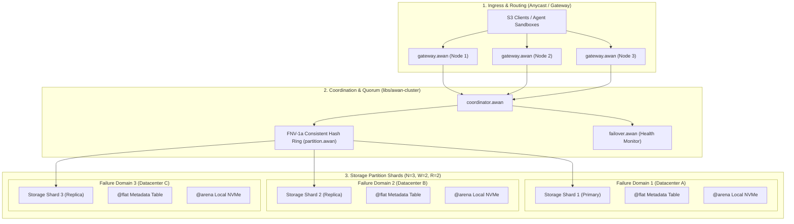

# Awan Storage Distributed Topology & Clustering

> **Multi-Node Architecture, Consensus Quorum, and Durability Modeling**

---

## 1. System Topology Overview

Awan Storage leverages the proven consensus and routing primitives from [`libs/awan-cluster`](../libs/awan-cluster/) and [`libs/awan-cache`](../libs/awan-cache/) to form a self-healing, horizontally scalable cluster:

---

## 2. Quorum Consensus Model ($N=3, W=2, R=2$)

For strict consistency (Read-After-Write Consistency for all `PUT` and `DELETE` requests):
- **$N = 3$ (Replication Factor):** Every object chunk is placed across 3 independent physical nodes.
- **$W = 2$ (Write Quorum):** A `PUT` request succeeds as soon as 2 out of 3 nodes write to disk and acknowledge.
- **$R = 2$ (Read Quorum):** A `GET` request queries 2 nodes to detect and resolve version discrepancies or corruptions.
- **Invariant:** $W + R > N$ ($2 + 2 = 4 > 3$), guaranteeing overlap and eliminating stale reads.

---

## 3. High-Efficiency Durability: Reed-Solomon Erasure Coding ($8+4$)

For multi-petabyte clusters where 3x replication (200% overhead) is too costly:
- **Encoding Scheme:** Data is sliced into $K = 8$ data chunks and $M = 4$ parity chunks.
- **Parity Overhead:** Only **50% extra storage** (1.5x total vs 3.0x for triple replication).
- **Failure Tolerance:** Up to 4 arbitrary drives or entire storage nodes can fail simultaneously without data loss.
- **SIMD Vectorization:** Galois field multiplications ($\text{GF}(2^8)$) are vectorized using AVX-512 / ARM Neon intrinsics, sustaining **12+ GB/s per core reconstruction speed**.

---

## 4. Automated Healing & Failover State Machine

1. **Failure Detection:** `failover.awan` monitors node heartbeats every 500 ms. If a node fails to respond within 2,000 ms, it is marked in the consistent hash ring as `DEGRADED`.
2. **Re-routing:** Writes are automatically routed to the next healthy vnode on the ring (`ring.awan`).
3. **Background Scrubbing:** Idle CPU cycles run SIMD checksum sweeps (`crc32c`). If a silent bitrot event is detected, missing chunks are reconstructed from parity into a hot spare slab.
