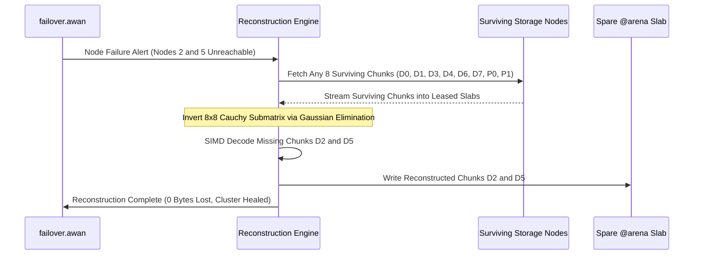

# Awan Storage Erasure Coding Specification ($8+4$ Cauchy Reed-Solomon)

> **Mathematical Formulation, Matrix Layouts, and SIMD Vectorized Reconstruction**

---

## 1. Overview & Durability Formulation

To achieve S3-scale durability without paying the 200% storage overhead of triple-replication, Awan Storage implements **Cauchy Reed-Solomon Erasure Coding**:
- **Data Chunks ($K$):** 8
- **Parity Chunks ($M$):** 4
- **Total Blocks ($N = K + M$):** 12
- **Storage Overhead:** Exactly **50%** (1.5x raw capacity vs 3.0x for 3x replication).
- **Fault Tolerance:** Any 4 out of the 12 storage nodes or drives can fail simultaneously without data loss.

---

## 2. Mathematical Model: Cauchy Distribution Matrix over $\text{GF}(2^8)$

Standard Vandermonde Reed-Solomon matrices require complex field inversions. Awan Storage utilizes **Cauchy Reed-Solomon matrices** over the Galois Field $\text{GF}(2^8)$ (with primitive polynomial $x^8 + x^4 + x^3 + x^2 + 1 = \text{0x11D}$):

### A. Cauchy Generator Matrix $A$
A $4 \times 8$ Cauchy matrix is constructed where each element $a_{i,j}$ is defined as:
$$a_{i,j} = \frac{1}{x_i \oplus y_j}$$
where $X = \{x_0, x_1, x_2, x_3\}$ and $Y = \{y_0, \dots, y_7\}$ are disjoint sets in $\text{GF}(2^8)$, and $\oplus$ denotes field addition (bitwise XOR).

### B. Parity Block Generation
The 4 parity chunks $P_0, P_1, P_2, P_3$ are computed via vector-matrix dot products against the 8 data chunks $D_0 \dots D_7$:
$$P_i = \sum_{j=0}^{7} a_{i,j} \otimes D_j$$
where $\otimes$ denotes Galois Field multiplication.

---

## 3. SIMD Vectorization: Look-Up Table (LUT) Kernels

Direct byte-by-byte Galois Field multiplication is CPU-intensive. Awan Storage utilizes **Intel AVX2 / AVX-512 and ARM Neon Vector Look-Up Tables (`vpshufb` / `vtbl1`)**:

1. For each constant coefficient $a_{i,j}$, precompute two 16-byte look-up tables (for the low 4 bits and high 4 bits of the input bytes).
2. The SIMD inner loop splits input vector registers into low and high nibbles using bitmask `0x0F`.
3. Parallel byte shuffles (`_mm256_shuffle_epi8`) evaluate 32 bytes simultaneously per clock cycle.
4. An AVX-512 core processes **64 bytes per instruction**, achieving **12+ GB/s encoding throughput per core**.

---

## 4. Failure Reconstruction State Machine

1. **Detection:** When `failover.awan` detects that $F \le 4$ nodes are degraded, it schedules an asynchronous rebuild task.
2. **Scatter Read:** The cluster fetches any $K = 8$ surviving chunks in parallel over the internal 10 Gbps/100 Gbps network.
3. **Matrix Inversion:** An $8 \times 8$ submatrix corresponding to the surviving chunks is extracted from the Cauchy matrix and inverted using Gaussian elimination in $\text{GF}(2^8)$.
4. **Decoding:** The inverted matrix is multiplied against the surviving 8 chunks to decode the missing $F$ chunks.
5. **Placement:** Reconstructed chunks are written to fresh spare slabs on healthy nodes.
