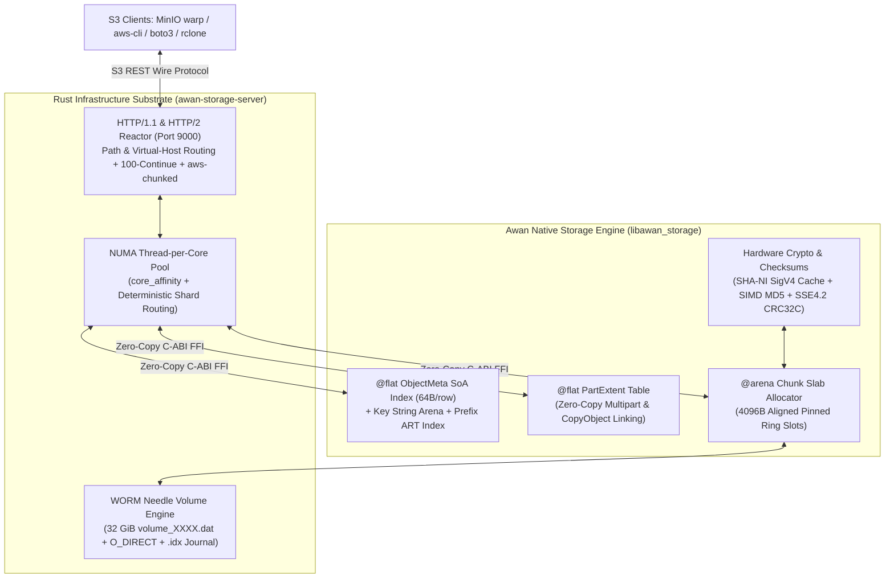
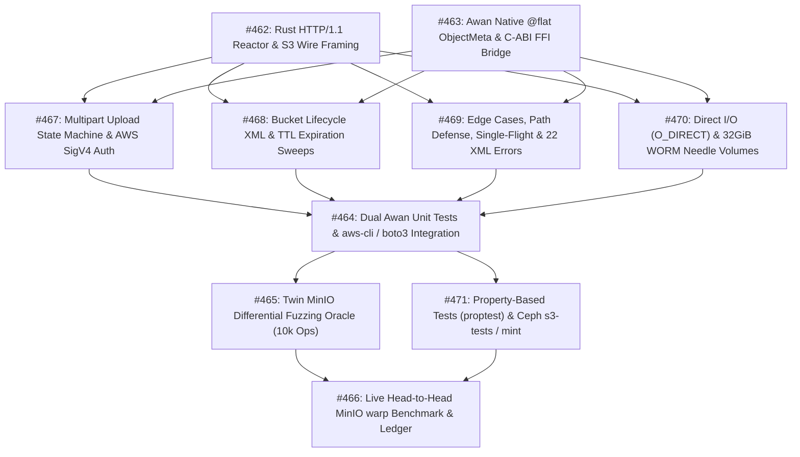

# Awan Storage: Hybrid S3 Substrate & MinIO Benchmark PoC Specification

> **Specification for Phase 2 Fast-Track Drop-In S3 PoC**  
> **Architecture: Rust Network/Thread/Volume Substrate + Awan Compiled Native `@flat` SoA Engine**  
> **Oracle & Benchmark Targets: MinIO Differential Fuzzing Oracle, Ceph `s3-tests`, & MinIO `warp` Suite**

---

## 1. Architectural Strategy & Rationale

### 1.1 The Problem: Infrastructure Plumbing vs Engine Proof
The core performance thesis of Awan Storage is built on three pillars:
1. Contiguous `@flat ObjectMeta` Struct-of-Arrays (SoA) layout paired with a Key String Arena and Adaptive Radix Tree (ART) prefix index eliminates pointer chasing, CPU cache misses, and garbage collection pauses.
2. Preallocated 4096-byte aligned `@arena` chunk slabs paired with append-only WORM Needle Volume files (`O_DIRECT` / `FILE_FLAG_NO_BUFFERING`) eliminate dynamic heap allocation (`malloc`/`free`), OS PageCache double-buffering, and filesystem inode thrashing.
3. Hardware-accelerated SIMD intrinsics (Intel SHA-NI, ARMv8 Crypto, SSE4.2 CRC32C) saturate network and NVMe bus bandwidth without CPU bottlenecks.

Building a pure-Awan async completion reactor ([Issue #53](https://github.com/iskandarnorazli/awan-lang/issues/53)) and native columnar file I/O ([Issue #202](https://github.com/iskandarnorazli/awan-lang/issues/202)) in the compiler first would delay live S3 benchmarks by months.

### 1.2 The Solution: Standard Substrate / Host Pattern
We employ the **Substrate / Host Architecture**:
- **Rust Substrate (`awan-storage-server`)**: Provides non-blocking HTTP/1.1 & HTTP/2 socket completion on port `9000`, `SO_REUSEPORT` listener partitioning, NUMA thread-per-core worker pinning (`core_affinity`), `aws-chunked` streaming decoding, and 4096-byte aligned Direct I/O volume backing.
- **Awan Native Engine (`libawan_storage`)**: Compiles Awan's `@flat ObjectMeta` SoA index, `@flat PartExtent` multipart table, Key String Arena, and `@arena` slab allocator into a native C-ABI library called directly by the Rust workers with zero heap copies.
- **MinIO as Differential Oracle**: Validates 100% status code, header, ETag, and byte-for-byte payload parity against a live local `minio server` instance before running `warp`.



---

## 2. Complete Drop-In S3 REST API Surface

### 2.1 Bucket, Object, Multipart & Lifecycle Operations

| Category | HTTP Verb | URI Pattern | S3 Operation | Required Support & Response Contract |
|---|---|---|---|---|
| **Service** | `GET` | `/` | `ListBuckets` | `200 OK` (`<ListAllMyBucketsResult>` XML) |
| **Bucket** | `PUT` | `/{bucket}` | `CreateBucket` | Validates name (3–63 chars); idempotent `200 OK` (`400 InvalidBucketName`) |
| **Bucket** | `HEAD` | `/{bucket}` | `HeadBucket` | Pre-flight check for `warp` & SDKs: `200 OK` or `404 NoSuchBucket` |
| **Bucket** | `DELETE` | `/{bucket}` | `DeleteBucket` | `204 No Content` if empty; `409 BucketNotEmpty` if live keys exist |
| **Bucket** | `GET` | `/{bucket}?location` | `GetBucketLocation` | `200 OK` (`<LocationConstraint>us-east-1</LocationConstraint>`) |
| **Listing** | `GET` | `/{bucket}?list-type=2` | `ListObjectsV2` | Lexicographical UTF-8 order via ART (`prefix`, `delimiter`, `max-keys`, `continuation-token`, `start-after`) |
| **Batch** | `POST` | `/{bucket}?delete` | `DeleteObjects` | Multi-key batch delete (up to 1,000 keys/request; required by `warp` cleanup) |
| **Object** | `PUT` | `/{bucket}/{key+}` | `PutObject` | Supports single-chunk, `UNSIGNED-PAYLOAD`, `aws-chunked`, `Expect: 100-continue`, conditional headers. Returns `200 OK` + 128-bit MD5 `ETag` |
| **Object** | `PUT` | `/{bucket}/{key+}` | `CopyObject` | Header `x-amz-copy-source`: zero-copy extent ref-count clone (`200 OK` XML) |
| **Object** | `GET` | `/{bucket}/{key+}` | `GetObject` | Full or RFC 9110 `Range: bytes=...` (`200 OK`, `206 Partial Content`, `304`, `404`, `412`, `416`) |
| **Object** | `HEAD` | `/{bucket}/{key+}` | `HeadObject` | Identical metadata headers to `GET` with 0 body bytes |
| **Object** | `DELETE` | `/{bucket}/{key+}` | `DeleteObject` | Sets tombstone in `@flat ObjectMeta` (`204 No Content`) |
| **Multipart**| `POST` | `/{bucket}/{key+}?uploads` | `CreateMultipartUpload`| Allocates `UploadId` and staging manifest (`200 OK` XML) |
| **Multipart**| `PUT` | `/{bucket}/{key+}?partNumber=N&uploadId=ID` | `UploadPart` | Validates $1 \le N \le 10,000$; stages part needle; returns part `ETag` |
| **Multipart**| `POST` | `/{bucket}/{key+}?uploadId=ID` | `CompleteMultipartUpload`| Validates ascending order, ETags, $\ge 5\text{ MiB}$ size; links `@flat PartExtent`; returns composite `ETag: "<md5>-<parts>"` |
| **Multipart**| `DELETE` | `/{bucket}/{key+}?uploadId=ID` | `AbortMultipartUpload` | Frees staged part needles (`204 No Content` or `404 NoSuchUpload`) |
| **Multipart**| `GET` | `/{bucket}/{key+}?uploadId=ID` | `ListParts` | Returns XML list of staged parts for `uploadId` |
| **Multipart**| `GET` | `/{bucket}?uploads` | `ListMultipartUploads` | Returns XML list of in-progress uploads in bucket |
| **Lifecycle**| `PUT/GET/DELETE` | `/{bucket}?lifecycle` | `BucketLifecycle` | Configures/queries/deletes `Expiration.Days` and `AbortIncompleteMultipartUpload` rules |

---

## 3. C-ABI FFI Boundary (`libawan_storage`)

The Rust substrate invokes Awan's native engine across a panic-safe (`std::panic::catch_unwind`), zero-copy `extern "C"` boundary defined in `awan-storage/server/include/awan_storage.h`:

```c
// awan_storage.h — 64-byte cache-line-aligned metadata record
typedef struct {
    uint64_t key_hash;      // 64-bit keyed XXH3 / SipHash-1-3 of (bucket_id, key)
    uint64_t bucket_flags;  // [63:32] bucket_id | [31:16] part_count | [15:0] flags
    uint64_t vol_offset;    // [63:48] volume_id | [47:0] 4KB-aligned offset or PartExtent idx
    uint64_t size;          // Decoded payload byte length
    uint64_t etag_hi;       // Upper 64 bits of 128-bit MD5 digest
    uint64_t etag_lo;       // Lower 64 bits of 128-bit MD5 digest
    uint64_t created_at;    // Unix epoch timestamp (ms)
    uint64_t key_slice;     // [63:16] Key String Arena offset | [15:0] key_len
} AwanObjectMeta;

// Return codes (all negative values represent structured errors; panics never unwind)
#define AWAN_OK                     0
#define AWAN_ERR_NOT_FOUND         -1
#define AWAN_ERR_BUCKET_NOT_FOUND  -2
#define AWAN_ERR_BUCKET_NOT_EMPTY  -3
#define AWAN_ERR_PRECONDITION      -4
#define AWAN_ERR_CAPACITY          -5
#define AWAN_ERR_INVALID_ARG       -6
#define AWAN_ERR_PANIC           -999

// Engine lifecycle
void*   awan_storage_init(uint64_t max_objects, uint64_t key_arena_bytes, uint64_t slab_bytes);
void    awan_storage_destroy(void* engine);

// Bucket operations
int32_t awan_storage_bucket_create(void* engine, const uint8_t* name_ptr, uint32_t name_len, uint32_t* out_bucket_id);
int32_t awan_storage_bucket_lookup(void* engine, const uint8_t* name_ptr, uint32_t name_len, uint32_t* out_bucket_id);
int32_t awan_storage_bucket_delete(void* engine, uint32_t bucket_id);

// Object index operations (with full key verification in Key String Arena)
int32_t awan_storage_index_put(
    void* engine,
    uint32_t bucket_id,
    const uint8_t* key_ptr,
    uint16_t key_len,
    uint64_t vol_offset,
    uint64_t size,
    uint64_t etag_hi,
    uint64_t etag_lo,
    uint16_t part_count,
    uint16_t flags
);

int32_t awan_storage_index_get(
    void* engine,
    uint32_t bucket_id,
    const uint8_t* key_ptr,
    uint16_t key_len,
    AwanObjectMeta* out_meta
);

int32_t awan_storage_index_delete(
    void* engine,
    uint32_t bucket_id,
    const uint8_t* key_ptr,
    uint16_t key_len
);

// Lexicographical UTF-8 prefix scan for ListObjectsV2
int64_t awan_storage_index_scan(
    void* engine,
    uint32_t bucket_id,
    const uint8_t* prefix_ptr,
    uint16_t prefix_len,
    const uint8_t* start_after_ptr,
    uint16_t start_after_len,
    uint32_t max_keys,
    AwanObjectMeta* out_records
);
```

---

## 4. Milestone #10 Execution & Dependency Graph (Issues #462–#471)



| Issue | Layer | Core Deliverable & Gate Summary |
|---|---|---|
| **[#462](https://github.com/iskandarnorazli/awan-lang/issues/462)** | Rust Substrate | Bucket (`Create`/`Head`/`Delete`/`List`/`DeleteObjects`) + Object (`PUT`/`GET`/`HEAD`/`DELETE`/`Range`/`100-continue`) reactor on `:9000`. |
| **[#463](https://github.com/iskandarnorazli/awan-lang/issues/463)** | Awan + FFI | 64B `@flat ObjectMeta` + Key String Arena + ART prefix index + `catch_unwind` C-ABI (`< 50 ns` lookup, 0 heap allocs). |
| **[#467](https://github.com/iskandarnorazli/awan-lang/issues/467)** | Protocol | Multipart (`Initiate`/`UploadPart`/`Complete`/`Abort`/`ListParts`), `@flat PartExtent` linking, SigV4 (`UNSIGNED-PAYLOAD` + `aws-chunked`). |
| **[#468](https://github.com/iskandarnorazli/awan-lang/issues/468)** | Lifecycle | `PUT/GET/DELETE /{bucket}?lifecycle`, async TTL object tombstoning, and stale incomplete multipart upload reclamation. |
| **[#469](https://github.com/iskandarnorazli/awan-lang/issues/469)** | Hardening | Zero-byte keys, folder markers, URI/UTF-8 validation, single-flight thundering herd coalescing, MVCC overwrite isolation, 22 S3 XML error codes. |
| **[#470](https://github.com/iskandarnorazli/awan-lang/issues/470)** | Storage I/O | 4096B-aligned `O_DIRECT` / `FILE_FLAG_NO_BUFFERING` WORM Needle volumes (`volume_XXXX.dat`), `.idx` crash replay, and background compaction. |
| **[#464](https://github.com/iskandarnorazli/awan-lang/issues/464)** | Testing | Awan `.test.awan` suites + Rust integration tests + end-to-end `aws-cli` and `boto3` compatibility suite. |
| **[#465](https://github.com/iskandarnorazli/awan-lang/issues/465)** | Oracle Fuzz | Twin harness (`minio :9000` vs `awan :9001`): 10,000 randomized requests asserting 100% status, header, ETag, and body parity. |
| **[#471](https://github.com/iskandarnorazli/awan-lang/issues/471)** | Conformance | Generative `proptest` mathematical invariants + Ceph `s3-tests` / MinIO `mint` conformance execution. |
| **[#466](https://github.com/iskandarnorazli/awan-lang/issues/466)** | Benchmark | Core-pinned `warp put`, `warp get`, `warp mixed` vs MinIO recorded in `docs/measurements/s3_warp_minio_vs_awan.md` and `docs/PERF_CLAIMS_LEDGER.md`. |

---

## 5. Multi-Tiered Testing & MinIO Differential Oracle

### 5.1 Property-Based Invariants (`proptest` & Awan Generative Tests)
1. **Roundtrip Identity:** $\forall b, k, v: \text{GET}(b, k) \text{ after } \text{PUT}(b, k, v)$ returns status `200`, `ETag == MD5(v)`, and body `== v`.
2. **RFC 9110 Range Slicing:** $\forall s, e \in [0, |v|-1], s \le e: \text{GET\_RANGE}(b, k, s, e) == v[s..=e]$ with `206 Partial Content`.
3. **Multipart Equivalence:** Splitting payload $v$ into $P$ arbitrary chunks and completing a multipart upload yields the exact same byte stream on `GET` and `Range` as a single `PUT(v)`.
4. **MVCC Overwrite Isolation:** A concurrent reader streaming $v_1$ while a writer commits $v_2$ receives either 100% of $v_1$ or 100% of $v_2$, never a mixed buffer.
5. **Crash Truncation Safety:** Appending random truncated bytes (`1..4095` bytes) to the tail of `volume_0001.dat` and restarting the server recovers all previously committed objects with zero corruption.

### 5.2 Twin-Instance MinIO Differential Fuzzing (`#465`)
Every operation generated by the fuzzer is sent identically to `minio` (`127.0.0.1:9000`) and `awan-storage-server` (`127.0.0.1:9001`). The comparator checks:
- Exact HTTP status code (`200`, `204`, `206`, `304`, `400`, `403`, `404`, `409`, `412`, `416`).
- `ETag`, `Content-Length`, `Content-Range`, and `x-amz-meta-*` headers.
- XML `<Error><Code>` on error responses and `<ListBucketResult>` keys/prefixes on `ListObjectsV2`.
- SHA-256 digest of response bodies.

---

## 6. Head-to-Head `warp` Benchmark Protocol (`#466`)

```bash
# 1. Start MinIO baseline (pinned to physical cores 0-3)
taskset -c 0,1,2,3 minio server .tmp/minio_data --address 127.0.0.1:9000

# 2. Run warp benchmark suite against MinIO (pinned to cores 4-7)
taskset -c 4,5,6,7 warp put   --host 127.0.0.1:9000 --access-key minioadmin --secret-key minioadmin --duration 1m --obj.size 64KiB --concurrent 64 --json > minio_warp_put_64k.json
taskset -c 4,5,6,7 warp get   --host 127.0.0.1:9000 --access-key minioadmin --secret-key minioadmin --duration 1m --obj.size 64KiB --concurrent 64 --json > minio_warp_get_64k.json
taskset -c 4,5,6,7 warp mixed --host 127.0.0.1:9000 --access-key minioadmin --secret-key minioadmin --duration 1m --obj.size 64KiB --concurrent 64 --json > minio_warp_mixed_64k.json

# 3. Stop MinIO, start awan-storage-server (pinned to physical cores 0-3)
taskset -c 0,1,2,3 ./awan-storage-server --port 9000 --data .tmp/awan_data

# 4. Run identical warp benchmark suite against awan-storage-server
taskset -c 4,5,6,7 warp put   --host 127.0.0.1:9000 --access-key minioadmin --secret-key minioadmin --duration 1m --obj.size 64KiB --concurrent 64 --json > awan_warp_put_64k.json
taskset -c 4,5,6,7 warp get   --host 127.0.0.1:9000 --access-key minioadmin --secret-key minioadmin --duration 1m --obj.size 64KiB --concurrent 64 --json > awan_warp_get_64k.json
taskset -c 4,5,6,7 warp mixed --host 127.0.0.1:9000 --access-key minioadmin --secret-key minioadmin --duration 1m --obj.size 64KiB --concurrent 64 --json > awan_warp_mixed_64k.json
```

---

## 7. Migration & Upgrade Path to Pure Awan

1. **Phase 2A (Current Hybrid PoC)**: Rust substrate handles HTTP/1.1 & HTTP/2 socket framing, core pinning, and `O_DIRECT` volume files; Awan native engine (`libawan_storage`) owns the `@flat ObjectMeta` SoA index, `@flat PartExtent` table, Key String Arena, and `@arena` chunk slabs.
2. **Phase 2B (Native Columnar Persistence)**: When Issue #202 lands, `.idx` and `metadata.checkpoint` transition to Awan's native columnar `mmap` table loader.
3. **Phase 2C (Pure-Awan Completion Reactor)**: When Issue #53 lands, the Rust HTTP reactor is replaced by Awan's native `sys_ring_*` (`io_uring` / IOCP) reactor without altering the on-disk Needle Volume format or `@flat ObjectMeta` layout.
