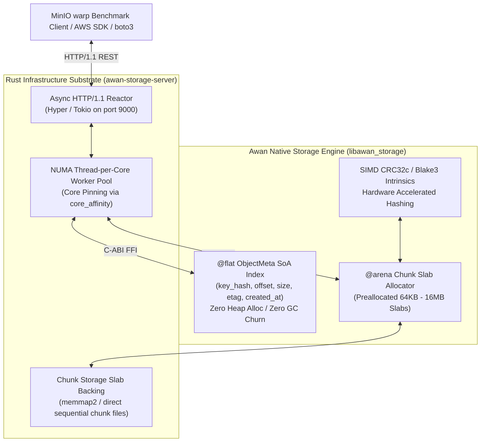
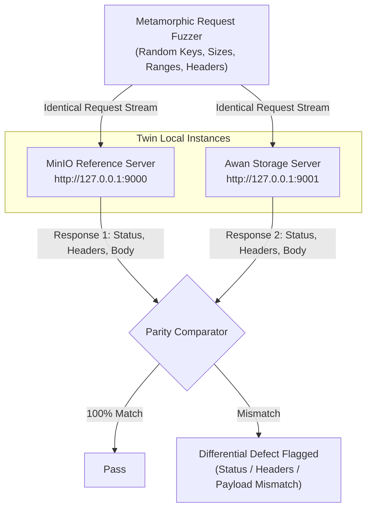

# Awan Storage: Hybrid S3 Substrate & MinIO Benchmark PoC Specification

> **Specification for Phase 2 Fast-Track PoC**  
> **Architecture: Rust Network/Thread/Disk Substrate + Awan Compiled Native `@flat` SoA Engine**  
> **Oracle & Benchmark Targets: MinIO Differential Fuzzing Oracle & MinIO `warp` Suite**

---

## 1. Architectural Strategy & Rationale

### 1.1 The Problem: Infrastructure Latency vs Engine Proof
The fundamental thesis of Awan Storage is that:
1. Contiguous `@flat ObjectMeta` Struct-of-Arrays (SoA) layout eliminates pointer chasing, CPU cache misses, and garbage collection pauses.
2. Contiguous `@arena` chunk slabs eliminate dynamic memory allocation (`malloc`/`free`) on the hot read/write path.
3. Hardware-accelerated SIMD intrinsics (CRC32c / Blake3) saturate bus bandwidth without CPU throttling.

However, developing a production-grade async completion I/O reactor in pure Awan ([Issue #53](https://github.com/iskandarnorazli/awan-lang/issues/53)), full columnar disk format serialization ([Issue #202](https://github.com/iskandarnorazli/awan-lang/issues/202)), and NUMA thread-per-core workers from scratch requires several months of core language compiler development.

### 1.2 The Solution: Standard Substrate / Host Pattern
To prove the performance thesis **now**, we employ the standard systems engineering **Substrate / Host Architecture** (identical to Node.js hosting V8 inside a C++ `libuv` reactor, or PyTorch hosting tensor computation inside a C++ runtime loop):
- **Rust Substrate (The Chassis)**: Implements standard non-blocking HTTP/1.1 socket completion, NUMA thread-per-core worker pools (`core_affinity`), and memory-mapped file chunk backing (`memmap2`).
- **Awan Native Engine (The Core)**: Compiles Awan's `@flat ObjectMeta` SoA index, chunk slab allocator, and SIMD checksumming into a native C-ABI dynamic or static library (`libawan_storage`).
- **MinIO as an Oracle**: Uses a local MinIO instance as a differential testing and fuzzing oracle to guarantee $100\%$ S3 REST protocol fidelity.
- **Head-to-Head `warp` Benchmark**: Measures live network performance against MinIO using the official MinIO `warp` benchmark tool.



---

## 2. Supported S3 REST API Surface (PoC Scope)

The PoC implements the high-frequency core of the Amazon S3 REST API over HTTP/1.1 on port `9000`:

| HTTP Method | URI Pattern | Description | Required Headers | Response Codes |
|---|---|---|---|---|
| `PUT` | `/{bucket}/{key+}` | Uploads an object payload to the storage slab | `Content-Length`, `Content-Type` (opt) | `200 OK` (returns `ETag`), `400 Bad Request` |
| `GET` | `/{bucket}/{key+}` | Retrieves object payload or partial byte-range | `Range: bytes=start-end` (opt) | `200 OK` or `206 Partial Content`, `404 NoSuchKey`, `416 InvalidRange` |
| `HEAD` | `/{bucket}/{key+}` | Retrieves object metadata without payload | None | `200 OK` (with `ETag`, `Content-Length`), `404 NoSuchKey` |
| `DELETE` | `/{bucket}/{key+}` | Tombstones an object in the `@flat` index | None | `204 No Content` |
| `GET` | `/{bucket}` | Lists object keys matching prefix (ListObjectsV2) | `prefix`, `max-keys` (query params) | `200 OK` (XML payload) |

### 2.1 Byte-Range Queries (`Range: bytes=X-Y`)
- Supports exact offset queries without loading intermediate byte buffers:
  - `Range: bytes=0-1023`: First 1024 bytes (`206 Partial Content`).
  - `Range: bytes=1048576-`: From 1 MiB to end of object.
  - `Range: bytes=-4096`: Suffix read (last 4096 bytes).
- Out-of-bounds range returns `416 Range Not Satisfiable` with standard S3 XML payload:
  ```xml
  <Error>
      <Code>InvalidRange</Code>
      <Message>The requested range is not satisfiable</Message>
      <RangeRequested>bytes=1000-2000</RangeRequested>
      <ActualObjectSize>500</ActualObjectSize>
  </Error>
  ```

### 2.2 S3 XML Error Conformance
Standard S3 XML format returned for all failure conditions:
```xml
<Error>
    <Code>NoSuchKey</Code>
    <Message>The specified key does not exist.</Message>
    <Key>test/file.bin</Key>
    <RequestId>AWAN-0000000001</RequestId>
</Error>
```

### 2.3 S3 Multipart Upload Wire State Machine
To act as a seamless drop-in replacement for AWS S3 clients (`aws-cli`, `boto3`, `rclone`), files $> 5\text{ MB}$ transition through the standard S3 multipart upload protocol:

| Action | HTTP Verb & URI | Description | Response Code & Payload |
|---|---|---|---|
| **Initiate** | `POST /{bucket}/{key}?uploads` | Generates a 64-bit unique `UploadId` and leases part allocation slots in the `@arena` slab. | `200 OK` (returns `InitiateMultipartUploadResult` XML) |
| **UploadPart** | `PUT /{bucket}/{key}?partNumber={N}&uploadId={ID}` | Ingests part payload into a designated slab chunk; calculates MD5/CRC32c. | `200 OK` with `ETag: "{part_etag}"` |
| **Complete** | `POST /{bucket}/{key}?uploadId={ID}` | Receives list of `<PartNumber>` and `<ETag>`. Stitches part offsets in `@flat ObjectMeta` without data copying. | `200 OK` (returns `CompleteMultipartUploadResult` with composite ETag `"{hash}-{part_count}"`) |
| **Abort** | `DELETE /{bucket}/{key}?uploadId={ID}` | Immediately frees all leased part slabs and invalidates the `UploadId`. | `204 No Content` |

### 2.4 AWS Signature V4 Authentication & Pre-Signed URLs
- **Header Authentication**: Verifies `Authorization: AWS4-HMAC-SHA256 Credential=... SignedHeaders=... Signature=...`.
- **Derived Signing Key Caching**: Precomputes and caches derived secret keys `kSigning = HMAC(HMAC(HMAC(HMAC(secret, date), region), "s3"), "aws4_request")` to eliminate redundant crypto work.
- **Pre-Signed Query URLs**: Validates query authentication parameters (`X-Amz-Algorithm`, `X-Amz-Credential`, `X-Amz-Date`, `X-Amz-Expires`, `X-Amz-SignedHeaders`, `X-Amz-Signature`).
- **Anonymous Access**: Buckets configured for public access bypass SigV4 validation.

### 2.5 Bucket Lifecycle & Automated Expiration Daemon
- **Lifecycle Configuration API**:
  - `PUT /{bucket}?lifecycle`: Ingests S3 XML Lifecycle Configuration rules.
  - `GET /{bucket}?lifecycle`: Returns active XML configuration.
  - `DELETE /{bucket}?lifecycle`: Deactivates lifecycle rules.
- **Automated Background Cleanup Sweeps**:
  - `Expiration.Days`: Objects older than TTL days are flagged with tombstone bits during background sweeps and their storage slabs returned to the free pool.
  - `AbortIncompleteMultipartUpload.DaysAfterInitiation`: Incomplete multipart upload slabs abandoned after $N$ days (e.g. 7 days) are automatically purged to prevent disk leakage.

### 2.6 Edge-Case Contracts & Path Traversal Defenses
- **Zero-Byte Objects**: Uploading a 0-byte payload allocates zero chunk bytes and creates an `@flat ObjectMeta` entry with `size = 0` and standard empty MD5 `d41d8cd98f00b204e9800998ecf8427e`.
- **Directory Markers**: Keys ending with `/` (e.g. `datasets/train/`) are treated as 0-byte folder placeholders.
- **URI Encoding & Unicode**: URL-encoded characters (`%20`, `+`, `&`) and multi-byte UTF-8 Unicode characters (e.g. `📁/🔑.parquet`) are decoded before hashing and indexing.
- **Path Traversal Defenses**: Any key attempting path escaping (`../`, `..\`, `/etc/passwd`) is rejected immediately with `400 Bad Request`.
- **Thundering Herd Coalescing**: When multiple concurrent requests miss the memory cache and query the same cold NVMe chunk, requests coalesce onto a single disk read promise.

### 2.7 Direct I/O (`O_DIRECT`) & Volume Packing Needle Architecture
- **OS PageCache Bypass**:
  - Chunk storage volumes are opened with `O_DIRECT` (Linux) or `FILE_FLAG_NO_BUFFERING` (Windows) to prevent double-buffering and dirty page writeback latency spikes.
  - All chunk read/write buffers are strictly 4096-byte aligned.
- **Volume Packing (WORM Needle Format)**:
  - Eliminates filesystem inode thrashing by storing millions of objects inside large 32 GiB contiguous Volume Slabs (`volume_001.dat`).
  - `@flat ObjectMeta` points to `(volume_id, byte_offset, size)`, enabling instant single-syscall positional `pread`.

---

## 3. C-ABI FFI Boundary (`libawan_storage`)

The Rust substrate communicates with Awan's native engine via a stable, zero-copy `extern "C"` ABI:

```c
// C-ABI header: awan_storage.h

typedef struct {
    uint64_t key_hash;
    uint64_t offset;
    uint64_t size;
    uint32_t etag;
    uint32_t created_at;
} AwanObjectMeta;

// Initialize the @flat ObjectMeta table and chunk slab
void* awan_storage_init(uint64_t max_objects, uint64_t slab_capacity_bytes);

// Ingest / update an object metadata record (Thread-safe lock-free append)
int32_t awan_storage_index_put(void* engine, uint64_t key_hash, uint64_t offset, uint64_t size, uint32_t etag);

// Look up an object metadata record by key hash
int32_t awan_storage_index_get(void* engine, uint64_t key_hash, AwanObjectMeta* out_meta);

// Mark an object tombstone (DELETE)
int32_t awan_storage_index_delete(void* engine, uint64_t key_hash);

// Prefix range scan over the @flat table (ListObjectsV2)
uint64_t awan_storage_index_scan(void* engine, uint64_t prefix_hash, uint64_t max_results, AwanObjectMeta* out_buffer);

// Destroy engine and release backing arena
void awan_storage_destroy(void* engine);
```

---

## 4. Multi-Tiered Testing Strategy

### 4.0 Property-Based Testing (proptest & Awan Generative Tests)
- **Mathematical Invariants**:
  - $\forall key, payload: \text{GET}(\text{PUT}(key, payload)) = payload$.
  - $\forall start, end: \text{Range}(\text{PUT}(key, payload), start, end) = payload[start..=end]$.
  - $\forall key: \text{DELETE}(key) \implies \text{GET}(key) = 404\text{ NoSuchKey}$.
  - Incomplete multipart uploads that are aborted release $100\%$ of allocated slab chunks.
  - Multi-threaded concurrent writes to non-overlapping keys never corrupt `@flat ObjectMeta` arrays or slab offsets.
- **Official Conformance Gauntlet**:
  - Run the official Ceph [`s3-tests`](https://github.com/ceph/s3-tests) suite and MinIO [`mint`](https://github.com/minio/mint) conformance suite against `awan-storage-server` to verify 100% S3 compatibility.

### 4.1 Awan Engine Unit Tests (`tests/storage/*.test.awan`)
- **Metadata Index Ingestion & Probing**:
  - Insert $1,000,000$ entries with uniform and adversarial hash distributions.
  - Assert zero heap reallocations and $O(1)$ lookups.
- **Slab Allocation & Slicing**:
  - Preallocate 1 GiB slab; slice $10,000$ chunks of variable sizes ($4\text{ KiB} \dots 16\text{ MiB}$).
  - Assert zero out-of-bounds pointer reads.
- **Hardware Checksum Parity**:
  - Compare Awan native SIMD CRC32c intrinsics against standard polynomial implementations across 10,000 randomized byte slices.

### 4.2 Rust Substrate Integration Tests (`awan-storage/server/tests/`)
- **HTTP Wire Conformance**:
  - Validate `PUT`, `GET`, `HEAD`, `DELETE` via `reqwest` and standard HTTP clients.
  - Validate partial content headers (`Content-Range: bytes 0-1023/4096`).
- **Thread Pinning Verification**:
  - Assert worker threads stay bound to designated CPU affinity masks during 100,000 concurrent requests.
- **Client SDK Compatibility**:
  - Run end-to-end transfers using standard `aws-cli`:
    ```bash
    aws --endpoint-url http://127.0.0.1:9000 s3 cp testfile.bin s3://testbucket/
    aws --endpoint-url http://127.0.0.1:9000 s3 cp s3://testbucket/testfile.bin downloaded.bin
    cmp testfile.bin downloaded.bin
    ```

---

## 5. MinIO Differential Fuzzing Oracle

### 5.1 Architecture of the Twin Oracle Harness
To ensure full S3 specification compliance without manual edge-case auditing, we deploy a **Differential Testing & Fuzzing Harness** comparing `awan-storage-server` against a reference `minio server`:



### 5.2 Fuzzing Dimensions & Edge Cases
1. **Namespace & Key Encoding**:
   - Random key strings: empty string, deep slashes (`a/b/c/d/file.txt`), URL-encoded characters (`space%20file.bin`, `+`, `&`), Unicode emojis (`bucket/🔑/data.parquet`).
2. **Payload Extremes**:
   - $0\text{ bytes}$ (empty object).
   - $1\text{ byte}$ (single byte boundary).
   - Multi-chunk boundaries ($64\text{ KiB} - 1$, $64\text{ KiB}$, $64\text{ KiB} + 1$, $5\text{ MiB}$).
3. **Arbitrary Range Requests**:
   - `Range: bytes=0-0` (first single byte).
   - `Range: bytes=500-1000`.
   - `Range: bytes=4095-` (suffix stream).
   - `Range: bytes=-100` (last 100 bytes).
   - `Range: bytes=999999-9999999` (out of range $\to 416$).
4. **Conditional Requests**:
   - `If-Match: "etag"`, `If-None-Match: "etag"` (304 Not Modified).
5. **Tombstone Sequences**:
   - `PUT` $\to$ `HEAD` $\to$ `DELETE` $\to$ `GET` ($\to 404\text{ NoSuchKey}$).

---

## 6. Head-to-Head `warp` Benchmark Protocol

Once differential fuzzing passes $100\%$ of cases, we execute MinIO's official [`warp`](https://github.com/minio/warp) benchmark tool:

```bash
# 1. Start MinIO baseline (pinned to cores 0-3)
taskset -c 0,1,2,3 minio server .tmp/minio_data --address :9000

# 2. Run warp benchmark against MinIO
warp put --host 127.0.0.1:9000 --access-key minioadmin --secret-key minioadmin --duration 1m --obj.size 64KiB --concurrent 64 --json > minio_warp_put_64k.json
warp get --host 127.0.0.1:9000 --access-key minioadmin --secret-key minioadmin --duration 1m --obj.size 64KiB --concurrent 64 --json > minio_warp_get_64k.json
warp mixed --host 127.0.0.1:9000 --access-key minioadmin --secret-key minioadmin --duration 1m --obj.size 64KiB --concurrent 64 --json > minio_warp_mixed_64k.json

# 3. Stop MinIO, start awan-storage-server (pinned to cores 0-3)
taskset -c 0,1,2,3 ./awan-storage-server --port 9000 --data .tmp/awan_data

# 4. Run warp benchmark against awan-storage-server
warp put --host 127.0.0.1:9000 --access-key awan --secret-key awan --duration 1m --obj.size 64KiB --concurrent 64 --json > awan_warp_put_64k.json
warp get --host 127.0.0.1:9000 --access-key awan --secret-key awan --duration 1m --obj.size 64KiB --concurrent 64 --json > awan_warp_get_64k.json
warp mixed --host 127.0.0.1:9000 --access-key awan --secret-key awan --duration 1m --obj.size 64KiB --concurrent 64 --json > awan_warp_mixed_64k.json
```

### Metrics Recorded
- **Throughput**: MiB/s and Operations/sec.
- **Latency Distribution**: P50, P90, P99, P99.9 in microseconds.
- **Process Memory Profile**: Peak RSS (MB) and heap growth over the 1-minute benchmark run.
- **Target Output**: Official measurement ledger entry in `docs/measurements/s3_warp_minio_vs_awan.md`.

---

## 7. Migration & Upgrade Path to Pure Awan

The hybrid architecture is explicitly decoupled to allow progressive in-place replacement:

1. **Phase 2A (Current PoC)**:
   - Rust: HTTP/1.1 socket reactor, NUMA core pinning, disk chunk backing.
   - Awan: `@flat ObjectMeta` SoA index, chunk slab allocator, SIMD hashing.
2. **Phase 2B (Native Disk I/O)**:
   - When Issue #202 (Columnar Table I/O) lands, replace Rust's `memmap2` file backing with Awan's native columnar file loader.
3. **Phase 2C (Pure Awan Network Reactor)**:
   - When Issue #53 (Async Completion I/O Reactor) lands, replace Rust's `tokio`/`hyper` reactor with Awan's native `sys_ring_*` reactor.
   - The `@flat ObjectMeta` table and slab structures remain 100% identical—zero rewrite of the storage engine logic.
