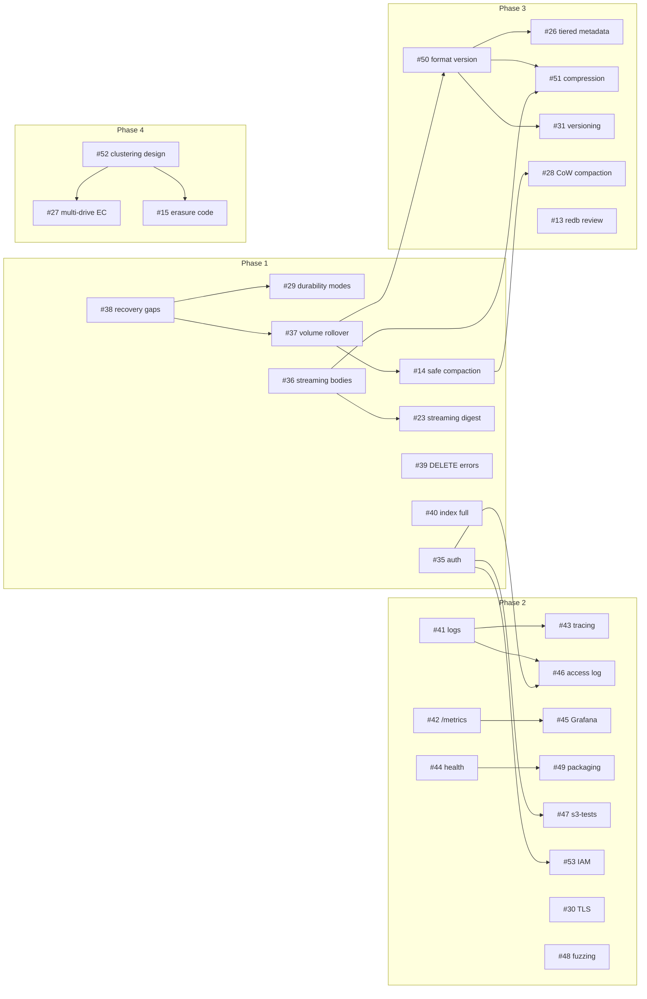

# AwanFS roadmap and dependencies

Plan of record since 2026-11-12. The GitHub milestones Phase 1-4 hold the issues, and GitHub's "blocked by" links record the order inside them. The decisions behind the plan are in [`ARCHITECTURE.md`](ARCHITECTURE.md#0-decisions-2026-11-12). The earlier plan, written while this code lived in awan-lang, is in git history.

## Phases

| Phase | Goal | Issues |
|---|---|---|
| 1. Correctness and security | Acknowledged data is kept and readable; only authorised clients get in; failures are errors | #35 auth, #38 recovery gaps, #29 durability modes, #37 volume rollover, #36 streaming bodies and size limit, #39 DELETE errors, #40 index full, #14 safe compaction; closing #12, #17, #18, #19, #22, #24 after #33, and #23 after #36 |
| 2. Production operations | What an operator needs to run it | #41 logs and request IDs, #42 `/metrics`, #43 tracing, #44 health, #45 Grafana and alerts, #46 access log, #47 s3-tests, #48 fuzzing, #49 packaging, #30 TLS, #53 IAM, #123 S3 conformance (#111-#122) |
| 3. Scale and efficiency | Grow past one disk's worth of metadata and data without losing speed | #50 format version, #26 tiered metadata and Bloom filter, #13 redb review, #51 compression, #28 compaction throttle, #104 copy-on-write cloning, #31 versioning |
| 4. Multi-node (future) | High availability across machines | #52 clustering design, #27 multi-drive erasure coding, #15 erasure and heartbeat code |

## Status (2026-11-13)

- **Phase 1:** done except #57 (multipart throughput on Linux CI).
- **Phase 2:** done except #58 (benchmark methodology for public claims) and S3 conformance: tracker #123, with area issues #111-#122 (244 of 838 ceph s3-tests pass).
- **Phase 3:** done (#13, #28, #31, #50, #51) except #26 and #104, both `unmeasured` (decisions 23 and 32).
- **Phase 4:** not started (decision 25: the #52 design note comes first).

## Order inside and across phases

An arrow points from an issue to the issues it unblocks.

## Gates

Every issue's gate is a test or a CI check. Two rules hold for all of them:
- No wall-clock thresholds. Performance is gated by exact work counts per request type (`server/tests/work_count_test.rs`) and by the nightly AwanFS/MinIO ratio (`benchmarks/ratio_check.py`).
- A test that fails before the change it guards, recorded in the commit message.
