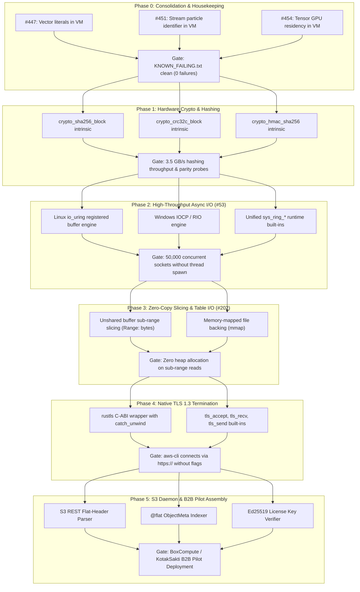

# Awan Storage Phased Roadmap & Dependency Graph

> **Execution Plan: Prerequisite Issues, Gates, and Phased Delivery**

---

## 1. Dependency Graph & Phase Sequencing

---

## 2. Detailed Phase Specifications & Gates

### Phase 0: VM Hardening Consolidation (Issues #447, #451, #454)
- **Objective:** Maintain Core Invariant 2 ("One oracle for every engine") by resolving all pending triaged failures in [`tests/KNOWN_FAILING.txt`](../tests/KNOWN_FAILING.txt).
- **Tasks:**
  1. Fix `Vector` literals and types in the VM compiler ([#447](https://github.com/iskandarnorazli/awan-lang/issues/447)).
  2. Fix stream particle pipeline identifier `B` resolution in VM ([#451](https://github.com/iskandarnorazli/awan-lang/issues/451)).
  3. Fix VM `Tensor` GPU residency assertion and `to_host` method ([#454](https://github.com/iskandarnorazli/awan-lang/issues/454)).
- **Exit Gate:** `bash tests/run_awan_tests.sh` passes 100% of tests with `KNOWN_FAILING.txt` completely empty.

---

### Phase 1: Hardware-Accelerated Crypto Intrinsics
- **Objective:** Replace scalar bitwise hashing with hardware-accelerated CPU instructions.
- **Tasks:**
  1. Add `crypto_sha256_block`, `crypto_crc32c_block`, and `crypto_hmac_sha256` to [`core/src/builtins/catalog.rs`](../core/src/builtins/catalog.rs).
  2. Implement pure-software reference in VM (`libs/awan-crypto/sha256.awan`).
  3. Implement native LLVM lowering in `llvm_bridge.rs` using Intel SHA extensions and ARMv8 Crypto intrinsics.
  4. Add parity probes in `core/tests/feature_parity_test.rs`.
- **Exit Gate:**
  - Hashing a 1 GB payload runs in $< 300\text{ ms}$ ($> 3.3\text{ GB/s}$ throughput per core).
  - Parity probes pass identical NIST test vectors on both VM and Native.

---

### Phase 2: Async Completion I/O Reactor (Issue #53)
- **Objective:** Eliminate thread-per-connection scaling bottleneck via kernel completion rings.
- **Tasks:**
  1. Implement `sys_ring_*` runtime abstraction in `core/src/runtime/reactor.rs`.
  2. Linux: Wire to `io_uring` with registered buffers.
  3. Windows: Wire to IOCP / Registered I/O (RIO).
  4. Expose non-blocking socket built-ins in `catalog.rs`.
- **Exit Gate:**
  - Benchmark sustains **50,000 idle TCP connections** using $< 200\text{ MB}$ RAM on both Windows and Linux CI runners.

---

### Phase 3: Zero-Copy Raw Buffer Slicing & Memory Mapping (Issue #202)
- **Objective:** Support S3 byte-range queries without allocating intermediate sub-arrays.
- **Tasks:**
  1. Implement `vssa_lower_slice` for unshared containers in `compiler_src/backend/vssa_builder.awan`.
  2. Add memory-mapped file handles (`mmap` / `MapViewOfFile`) in `core/src/runtime/`.
- **Exit Gate:**
  - Reading `Range: bytes=1048576-2097152` from a 10 GB file allocates **0 bytes** of heap and completes in $< 5\text{ µs}$.

---

### Phase 4: Native TLS 1.3 Termination
- **Objective:** Enable official AWS tools (`aws-cli`, Boto3, Go SDK) to connect over encrypted HTTPS.
- **Tasks:**
  1. Add `rustls` dependency to `core/Cargo.toml`.
  2. Wrap Rust TLS sessions in `extern "C"` functions with `std::panic::catch_unwind`.
  3. Expose `tls_accept`, `tls_recv`, and `tls_send` built-ins.
- **Exit Gate:**
  - `aws s3 cp test.bin s3://mybucket/ --endpoint-url https://localhost:9443` succeeds without `--no-verify-ssl` or insecure flags.

---

### Phase 5: S3 Daemon Assembly & B2B Pilot
- **Objective:** Assemble `awan-storage` daemon binary with license key verification for B2B deployment.
- **Tasks:**
  1. Assemble single-binary daemon: `awan-storage-server --config config.toml`.
  2. Integrate Ed25519 offline license verification ([`LICENSING_AND_COMMERCIAL.md`](LICENSING_AND_COMMERCIAL.md)).
  3. Deploy pilot instance with BoxCompute / KotakSakti agent sandboxes.
- **Exit Gate:**
  - Agent sandbox cold-start snapshot restoration completes in $< 15\text{ ms}$ under 500 concurrent container loads.
