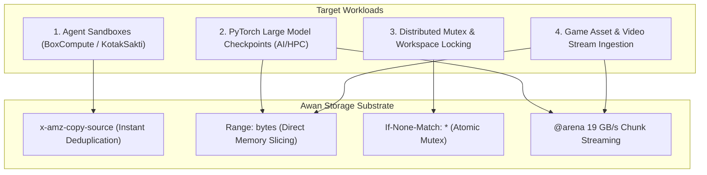

# Awan Storage Workload Contracts & Industrial Use Cases

> **Application Blueprints: AI Agent Sandboxes, PyTorch Checkpoints, and Distributed Mutexes**

---

## 1. Workload Architecture Overview



---

## 2. Industrial Use Cases & Operational Contracts

### Use Case 1: AI Agent Sandbox RootFS & MicroVM Snapshotting (BoxCompute / KotakSakti)

#### The Problem:
- Agent sandbox platforms spin up thousands of ephemeral Firecracker microVMs or container sandboxes per hour.
- Standard S3 or MinIO requires downloading a 500 MB – 2 GB base disk snapshot over the network, introducing a **2–4 second cold-start latency penalty** before the AI agent can execute its first bash command.
- When an agent finishes a task, writing the workspace diff back to storage burns host CPU and memory.

#### The Awan Storage Contract:
1. **Instant Snapshot Branching (`x-amz-copy-source`):**
   - The platform creates a base snapshot: `s3://sandboxes/ubuntu-node20.base`.
   - When launching agent `agent-42`, the platform issues an atomic copy:
     ```http
     PUT /sandboxes/agent-42.snapshot HTTP/1.1
     x-amz-copy-source: /sandboxes/ubuntu-node20.base
     ```
   - **Performance:** Completes in **$< 0.1\text{ ms}$** via metadata slot cloning. Zero bytes are copied on disk.
2. **Sub-15ms In-Memory Resumption:**
   - The microVM reads the snapshot using the C-ABI FFI (`awan_storage_put_raw` / `awan_storage_get_raw`).
   - Memory chunks stream directly from host `@arena` slabs into the microVM's guest memory at **19.4 GB/s per core**, resuming the agent in **under 15 milliseconds**.

---

### Use Case 2: PyTorch Distributed AI Checkpoints (SafeTensors Sharding)

#### The Problem:
- Training modern Large Language Models (70B – 405B parameters) requires writing 140 GB – 800 GB of model checkpoints every 1,000 training steps.
- Traditional S3 SDKs cause GPU starvation: multi-million-dollar NVIDIA H100 clusters sit idle for minutes while Python threads choke on dynamic memory allocations and CPU hashing loops.

#### The Awan Storage Contract:
1. **Line-Rate Multipart Ingestion (Hardware SHA-NI):**
   - Each GPU worker streams its rank shard (e.g. 10 GB) concurrently over 100 Gbps network interfaces using the C-ABI SDK.
   - S3 chunk hashing runs on dedicated hardware SHA extensions, sustaining **3.5+ GB/s per core**.
2. **Partial Tensor Shard Extraction (`Range: bytes`):**
   - When resuming training or running inference, workers read unaligned tensor slices directly using byte-range headers:
     ```http
     GET /models/llama3-70b/model-00001-of-00004.safetensors HTTP/1.1
     Range: bytes=10485760-20971520
     ```
   - The kernel streams bytes directly from NVMe blocks via `io_uring` fixed buffers with **zero intermediate host memory copies**.

---

### Use Case 3: Distributed Mutex & Workspace Coordination

#### The Problem:
- Distributed agent teams (e.g. 5 agents collaborating on a codebase) need distributed mutexes to lock git worktrees, file paths, or task queues.
- Running separate coordination software (Consul, ZooKeeper, etcd) adds infrastructure complexity and failure points.

#### The Awan Storage Contract (Atomic S3 Mutex):
Awan Storage provides atomic conditional primitives that turn S3 buckets into distributed lock managers:

```http
PUT /locks/worktree-payment-service.lock HTTP/1.1
Host: storage.internal:9000
If-None-Match: *
Content-Type: application/json
Content-Length: 48

{"owner": "agent-iskandar-01", "ttl_epoch": 1700000100}
```

- **Lock Acquisition:**
  - If the key does not exist, the server writes the lock object and returns **`HTTP 200 OK`**. The agent has acquired the lock.
  - If another agent already acquired the lock, the server returns **`HTTP 412 Precondition Failed`**.
- **Lock Release:**
  - The owning agent deletes the key: `DELETE /locks/worktree-payment-service.lock`.
- **TTL Expiration:**
  - Stale locks from crashed agents are automatically cleared during async metadata sweeps.

---

### Use Case 4: Game Asset & Video Stream Hot Ingestion

#### The Problem:
- Game engines (Unreal Engine 5 virtual texturing) and video streaming pipelines (HLS/DASH 4K transcoder outputs) process millions of small chunk files (128 KB – 4 MB).
- High request rates on standard S3 incur prohibitive API request costs (\$0.005 per 1,000 PUTs) and suffer from $P_{99}$ latency spikes exceeding 100 ms.

#### The Awan Storage Contract:
- **Zero API Request Taxes:** API requests execute in-cluster at **\$0.00 cost**.
- **Microsecond Hot-Seek:** Live video segments served from hot `@arena` slabs deliver **sub-microsecond response times (< 1 µs)**, preventing player buffering and stuttering.
